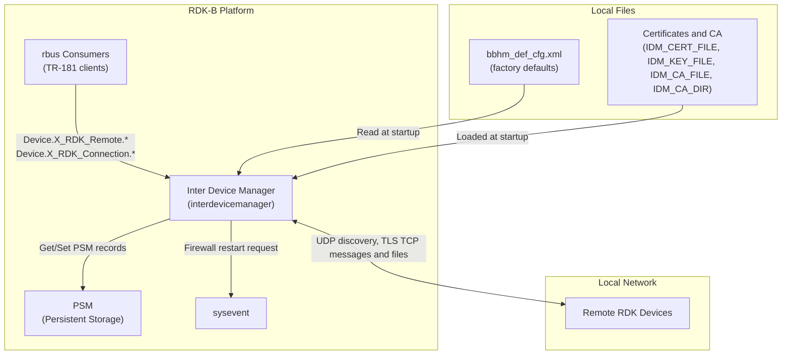
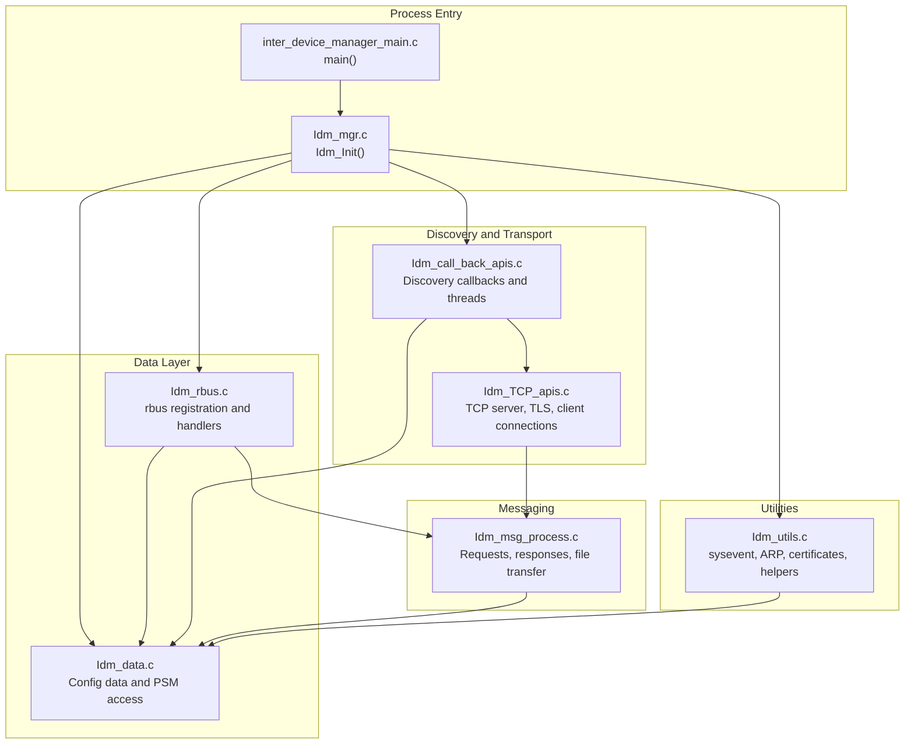
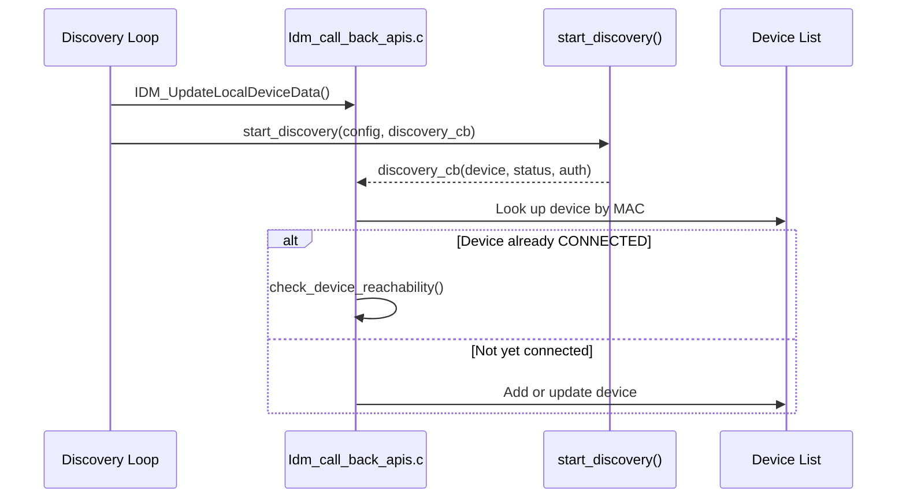
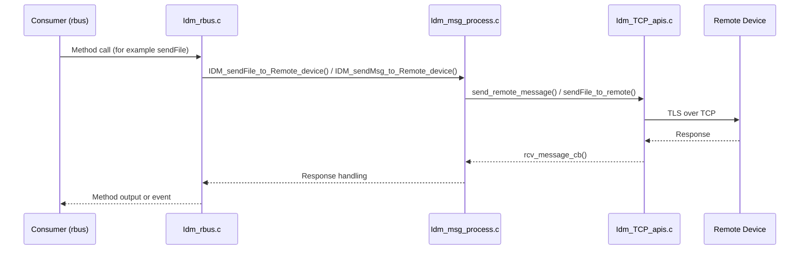

# Inter Device Manager Architecture

## Overview

This document describes the internal architecture of Inter Device Manager. It covers the system context, the major modules, how data flows between them, and the threads that run in the daemon.

---

## System Context

Inter Device Manager sits between platform consumers and the network. Platform consumers reach it through rbus. It reaches remote RDK devices directly over the network.

---

## High-Level Architecture

### Module Responsibilities

| Module               | Source Files                             | Responsibility                                                                          |
| -------------------- | ---------------------------------------- | --------------------------------------------------------------------------------------- |
| Process entry        | `inter_device_manager_main.c`            | Argument parsing, capability drop, daemonization, signal handlers                       |
| Initialisation       | `Idm_mgr.c`                              | Ordered startup of rbus, data, data model, sysevent, and discovery                      |
| Configuration data   | `Idm_data.c`, `Idm_data.h`               | Global configuration structure, PSM read and write, defaults, factory defaults          |
| rbus data model      | `Idm_rbus.c`, `Idm_rbus.h`               | rbus open, element registration, get/set/method handlers, event publishing              |
| Discovery callbacks  | `Idm_call_back_apis.c`                   | Discovery thread loop, discovery and connection callbacks, reachability checks          |
| Transport            | `Idm_TCP_apis.c`, `Idm_TCP_apis.h`       | Server socket, TLS setup, client connect, send and close helpers                        |
| Messaging            | `Idm_msg_process.c`, `Idm_msg_process.h` | Request and response queues, file send and get, subscriptions                           |
| Utilities            | `Idm_utils.c`, `Idm_utils.h`             | sysevent handling, device list operations, ARP lookup, MAC validation, interface status |

---

## Component Responsibilities

### Process Entry and Initialisation

`main()` in `inter_device_manager_main.c` runs the following steps:

1. Initialises the RDK logger when built with `FEATURE_SUPPORT_RDKLOG`.
2. Drops root capabilities.
3. Parses the certificate arguments and the `-subsys` and `-c` options.
4. Daemonizes unless `-c` is passed.
5. Installs signal handlers.
6. Calls `Idm_Init()`.

`Idm_Init()` runs these steps in order:

1. `Idm_Rbus_Init()` opens the rbus handle.
2. `IdmMgr_Data_Init()` loads configuration.
3. `Idm_Rbus_DM_Init()` registers data model elements.
4. `IDM_SyseventInit()` opens the sysevent connection.
5. `IDM_Start_Device_Discovery()` starts the discovery threads.

A failure in steps 1 to 3 is returned as a failure. A failure in step 4 closes sysevent. A failure in step 5 is only logged.

### Data Layer

The configuration data is a single global structure (`gpidmDmlInfo`) protected by a recursive mutex. Callers take it with `IdmMgr_GetConfigData_locked()` and release it with `IdmMgrDml_GetConfigData_release()`. The structure holds connection settings (`stConnectionInfo`) and the remote device list (`stRemoteInfo`).

Configuration values are persisted in PSM through rbus methods. Defaults and factory values are described in the [configuration guide](../configuration-guide.md).

### rbus Data Model Layer

`Idm_rbus.c` opens the rbus component `IDM_RBUS` and registers three element groups:

- `idmRmPublishElements`: remote device table, status and attribute properties, device change event, number of entries, and remote port.
- `idmConnHcElements`: connection properties (hello interval, subnet lists, detection window, interface, port) and the file transfer maximum size method.
- `idmRmCapElements`: capability methods, file transfer methods, file transfer status, the `Invoke()` method, and the discovery restart method.

See [components/data-model-layer.md](../components/data-model-layer.md) for the full element list.

### Discovery and Transport

- A discovery thread calls `IDM_UpdateLocalDeviceData()` and then `start_discovery()`. `start_discovery()` is declared in `Idm_call_back_apis.c` and implemented outside this repository. Discovery runs with the interval, detection window, interface, and port from configuration.
- The discovery callback (`discovery_cb`) records discovered devices and triggers reachability checks for devices that are already connected.
- The TCP server thread accepts TLS connections on the configured interface and port. The client path opens a TCP connection and runs `SSL_connect`.

See [components/discovery-and-transport.md](../components/discovery-and-transport.md).

### Messaging

Messages carry an operation (`SET`, `GET`, `IDM_SUBS`, `IDM_REQUEST`, `GFT`, `SFT`, `SFT_RES`) and a message type (`REQ` or `RES`). Incoming requests are queued and handled by `IDM_Incoming_req_handler_thread()`. Outgoing requests are tracked by request ID so that they can be matched with responses.

See [components/message-processing.md](../components/message-processing.md).

---

## Threads

| Thread                    | Created By                                        | Purpose                                                                      |
| ------------------------- | ------------------------------------------------- | ---------------------------------------------------------------------------- |
| Incoming request handler  | `IDM_Start_Device_Discovery()`                    | Processes queued incoming requests (`IDM_Incoming_req_handler_thread`)       |
| Discovery loop            | `IDM_Start_Device_Discovery()`                    | Refreshes local device data and runs discovery (`start_discovery_thread`)    |
| Discovery callback        | `discovery_cb()` in `Idm_call_back_apis.c`        | Handles discovered devices (`discovery_cb_thread`)                           |
| Rediscovery               | `discovery_cb()` in `Idm_call_back_apis.c`        | Repeats discovery when a local device is detected (`xupnp_rediscover_thread`) |
| TCP server                | `open_remote_connection()` in `Idm_TCP_apis.c`    | Accepts incoming TCP connections (`tcp_server_thread`)                       |

The TCP server thread starts only once, guarded by `TCP_server_started`.

---

## Data Flow

### Discovery

### Message Exchange

---

## Error Recovery

| Failure                                         | Handling                                                                                |
| ----------------------------------------------- | --------------------------------------------------------------------------------------- |
| rbus open or element registration fails         | `Idm_Init()` returns failure                                                            |
| Sysevent initialisation fails                   | Sysevent is closed; startup continues                                                   |
| Discovery thread creation fails                 | `IDM_Start_Device_Discovery()` returns failure, which is logged by `Idm_Init()`          |
| Local interface details unavailable             | `IDM_UpdateLocalDeviceData()` failure is logged and the discovery loop retries          |
| TLS context or certificate loading fails        | Server thread logs the error and returns without starting the listener                  |
| Crash signals (SIGSEGV, SIGBUS, SIGFPE, SIGILL) | Signal handler prints a backtrace and exits (or Breakpad handles the crash)             |

---

## Interface Architecture

### rbus

- Component name: `IDM_RBUS`.
- Data model root: `Device.X_RDK_Remote.*` and `Device.X_RDK_Connection.*`.

### PSM

- Configuration keys are read and written through rbus methods (`GetPSMRecordValue()` and `SetPSMRecordValue()` in `Idm_utils.c`).

### sysevent

- Used for a firewall restart request (`SYSEVENT_FIREWALL_RESTART`) before discovery starts.

### Network

- Discovery uses UDP (`SOCK_DGRAM`).
- Messaging uses TCP (`SOCK_STREAM`) with TLS.

---

## Security Architecture

- The TCP server creates its TLS context with `SSL_CTX_new(SSLv23_method())` and loads certificates through `load_certificate()`. This runs only when the component is not built with `IDM_DEBUG`.
- Certificate and key paths come from the environment variables set by `ssl.conf` (`IDM_CERT_FILE`, `IDM_KEY_FILE`, `IDM_CA_FILE`, `IDM_CA_DIR`).
- Incoming connections are checked by `verify_client()` in `Idm_TCP_apis.c`.
- Root capabilities are dropped at startup in `main()`.
- With `ENABLE_HW_CERT_USAGE`, certificate data can be loaded from a secure element through `load_se_cert()` in `Idm_utils.c`. The certificate, passcode file, and CA are passed as additional `main()` arguments.

---

## Build Variants

| Macro                    | Effect                                                                                          |
| ------------------------ | ----------------------------------------------------------------------------------------------- |
| `IDM_DEBUG`              | Skips TLS context creation and certificate loading in `tcp_server_thread` (`Idm_TCP_apis.c`)    |
| `ENABLE_HW_CERT_USAGE`   | Enables secure element certificate handling                                                     |
| `INCLUDE_BREAKPAD`       | Replaces the signal handlers with Google Breakpad                                               |
| `FEATURE_SUPPORT_RDKLOG` | Initialises the RDK logger                                                                      |
| `ENABLE_SD_NOTIFY`       | Set by `--enable-notify`. No source file in the repository reads it.                            |
| `DROP_ROOT_EARLY`        | Set by `--enable-dropearly`. No source file in the repository reads it.                         |
| `GTEST_ENABLE`           | Enables the gtest application (`--enable-gtestapp`)                                             |

`IDM_DEBUG`, `ENABLE_HW_CERT_USAGE`, `INCLUDE_BREAKPAD`, and `FEATURE_SUPPORT_RDKLOG` are not defined by `configure.ac` in this repository. They must be supplied by the build environment. See [configuration-guide.md](../configuration-guide.md).
