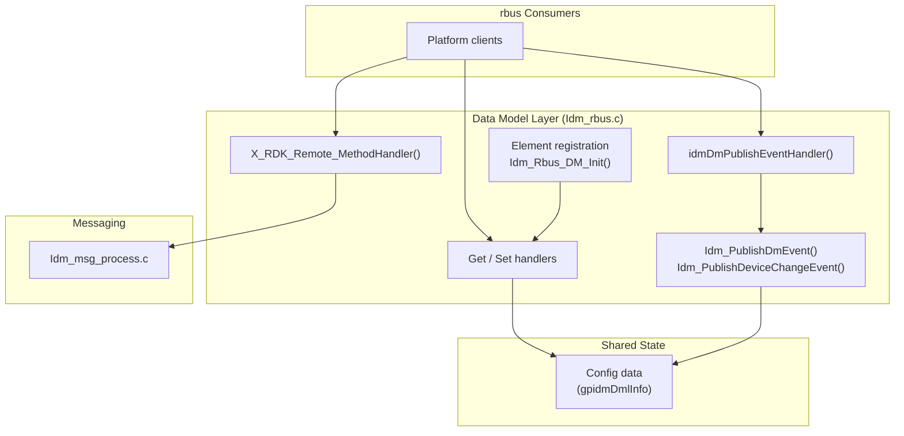

# Data Model Layer

## Overview

The data model layer exposes Inter Device Manager to platform consumers through rbus. It is implemented in `Idm_rbus.c` and declared in `Idm_rbus.h`. The layer registers TR-181 style elements under `Device.X_RDK_Remote.*` and `Device.X_RDK_Connection.*`, and routes get, set, method, and event requests to handlers.

For the system-level view, see [architecture/component-diagram.md](../architecture/component-diagram.md).

---

## Architecture

---

## Registered Elements

Element arrays are declared in `Idm_rbus.c` and registered in `Idm_Rbus_DM_Init()` in this order.

### Remote Device Group (`idmRmPublishElements`)

| Element                                      | Type                       | Handlers                                             |
| -------------------------------------------- | -------------------------- | ---------------------------------------------------- |
| `Device.X_RDK_Remote.Device`                 | Table                      | None                                                 |
| `Device.X_RDK_Remote.Device.{i}.Status`      | Property and event         | Get: `X_RDK_Remote_Device_GetHandler`                |
| `Device.X_RDK_Remote.Device.{i}.MAC`         | Property and event         | Get: `X_RDK_Remote_Device_GetHandler`                |
| `Device.X_RDK_Remote.Device.{i}.HelloInterval` | Property and event       | Get: `X_RDK_Remote_Device_GetHandler`                |
| `Device.X_RDK_Remote.Device.{i}.IPv4`        | Property and event         | Get: `X_RDK_Remote_Device_GetHandler`                |
| `Device.X_RDK_Remote.Device.{i}.IPv6`        | Property and event         | Get: `X_RDK_Remote_Device_GetHandler`                |
| `Device.X_RDK_Remote.Device.{i}.Capabilities` | Property and event        | Get: `X_RDK_Remote_Device_GetHandler`                |
| `Device.X_RDK_Remote.Device.{i}.ModelNumber` | Property and event         | Get: `X_RDK_Remote_Device_GetHandler`                |
| `Device.X_RDK_Remote.DeviceChange`           | Event                      | Event: `idmDmPublishEventHandler`                    |
| `Device.X_RDK_Remote.DeviceNumberOfEntries`  | Property and event         | Get: `X_RDK_Remote_Device_GetHandler`                |
| `Device.X_RDK_Remote.Port`                   | Property and event         | Get: `X_RDK_Remote_Device_GetHandler`, Set: `X_RDK_Remote_Device_SetHandler` |

### Connection Group (`idmConnHcElements`)

| Element                                      | Type                       | Handlers                                                        |
| -------------------------------------------- | -------------------------- | --------------------------------------------------------------- |
| `Device.X_RDK_Connection.HelloInterval`      | Property                   | Get and Set: `X_RDK_Connection_GetHandler` / `X_RDK_Connection_SetHandler` |
| `Device.X_RDK_Connection.HelloIPv4SubnetList` | Property                  | Get: `X_RDK_Connection_GetHandler`                              |
| `Device.X_RDK_Connection.HelloIPv6SubnetList` | Property                  | Get: `X_RDK_Connection_GetHandler`                              |
| `Device.X_RDK_Connection.DetectionWindow`    | Property                   | Get and Set: `X_RDK_Connection_GetHandler` / `X_RDK_Connection_SetHandler` |
| `Device.X_RDK_Connection.Interface`          | Property and event         | Get and Set: `X_RDK_Connection_GetHandler` / `X_RDK_Connection_SetHandler` |
| `Device.X_RDK_Connection.Port`               | Property and event         | Get and Set: `X_RDK_Connection_GetHandler` / `X_RDK_Connection_SetHandler` |

### Remote Capability and Method Group (`idmRmCapElements`)

| Element                                          | Type                     | Handler                          |
| ------------------------------------------------ | ------------------------ | -------------------------------- |
| `Device.X_RDK_Remote.AddDeviceCapabilities()`    | Method                   | `X_RDK_Remote_MethodHandler`     |
| `Device.X_RDK_Remote.RemoveDeviceCapabilities()` | Method                   | `X_RDK_Remote_MethodHandler`     |
| `Device.X_RDK_Remote.ResetDeviceCapabilities()`  | Method                   | `X_RDK_Remote_MethodHandler`     |
| `Device.X_RDK_Remote.FileTransferMaxSize()`      | Method                   | `X_RDK_Remote_MethodHandler`     |
| `Device.X_RDK_Remote.getFile()`                  | Method                   | `X_RDK_Remote_MethodHandler`     |
| `Device.X_RDK_Remote.sendFile()`                 | Method                   | `X_RDK_Remote_MethodHandler`     |
| `Device.X_RDK_Remote.FileTransferStatus()`       | Method and event         | `X_RDK_Remote_MethodHandler`, `idmDmPublishEventHandler` |
| `Device.X_RDK_Remote.Invoke()`                   | Method and event         | `X_RDK_Remote_MethodHandler`     |
| `Device.X_RDK_Connection.Restart()`              | Method                   | `X_RDK_Remote_MethodHandler`     |

---

## Key Components

| Function                                  | Purpose                                                                                     |
| ----------------------------------------- | ------------------------------------------------------------------------------------------- |
| `Idm_Rbus_Init()`                         | Opens the rbus handle with component name `IDM_RBUS`                                        |
| `Idm_Rbus_DM_Init()`                      | Registers the three element arrays, then creates the local device entry (`Idm_Create_Rbus_Obj()`) |
| `Idm_Create_Rbus_Obj()`                   | Creates the remote device entry and registers its table row (`rbusTable_registerRow`)       |
| `X_RDK_Remote_Device_GetHandler()`        | Returns remote device status, MAC, hello interval, addresses, capabilities, and entry count |
| `X_RDK_Remote_Device_SetHandler()`        | Sets the remote port                                                                        |
| `X_RDK_Connection_GetHandler()`           | Returns connection settings                                                                 |
| `X_RDK_Connection_SetHandler()`           | Sets connection settings                                                                    |
| `X_RDK_Remote_MethodHandler()`            | Dispatches method calls to messaging (`IDM_sendMsg_to_Remote_device`, `IDM_sendFile_to_Remote_device`, `IDM_getFile_from_Remote_device`) and to discovery restart |
| `idmDmPublishEventHandler()`              | Handles subscribe and unsubscribe actions for published events                              |
| `Idm_PublishDmEvent()`                    | Publishes a value change for a named parameter                                              |
| `Idm_PublishDeviceChangeEvent()`          | Publishes a device change event                                                             |
| `Idm_Rbus_DM_Init()` / `Idm_RbusExit()`   | Register and unregister all element arrays                                                  |
| `Idm_UpdateMeshConnectionValue()`         | Called from discovery callbacks to refresh connection values (declared in `Idm_msg_process.h`, defined in `Idm_rbus.c`) |

---

## Processing Flow

### Get Request

1. The consumer requests a property.
2. rbus calls the element's get handler.
3. The handler takes the configuration lock with `IdmMgr_GetConfigData_locked()`.
4. The handler reads the value from the configuration structure and releases the lock with `IdmMgrDml_GetConfigData_release()`.

### Set Request

1. The consumer sets a property with a set handler.
2. The handler updates the configuration structure under the configuration lock.
3. The new value is persisted with `IdmMgr_write_IDM_ParametersToPSM()` (`Idm_data.c`).

### Method Call

1. The consumer calls a method such as `sendFile()`.
2. `X_RDK_Remote_MethodHandler()` reads the input parameters.
3. The handler calls the matching messaging function. See [components/message-processing.md](message-processing.md).

### Event Publishing

1. A consumer subscribes to an event element.
2. `idmDmPublishEventHandler()` records the subscription.
3. When a value changes, `Idm_PublishDmEvent()` or `Idm_PublishDeviceChangeEvent()` publishes it.

Remote device entries are registered as table rows with `rbusTable_registerRow()` when devices are added.

---

## Integration Points

| Component                     | Interaction                                                         |
| ----------------------------- | ------------------------------------------------------------------- |
| rbus                          | Component registration, element registration, get/set/method/event |
| PSM                           | Configuration persistence through rbus helper methods               |
| Message processing            | Method calls for file transfer and messages                         |
| Discovery and transport       | Device list updates used by the remote device table                 |

---

## Error Handling

| Condition                                   | Behaviour                                                                 |
| ------------------------------------------- | ------------------------------------------------------------------------- |
| `rbus_open()` fails                         | `Idm_Rbus_Init()` returns `ANSC_STATUS_FAILURE`, and `Idm_Init()` stops  |
| Element registration fails                  | `Idm_Rbus_DM_Init()` returns failure                                      |

---

## Notes

- The TR-181 folder contains no C sources. The data model handlers are implemented in `Idm_rbus.c`.
- Element names are defined as macros at the top of `Idm_rbus.c`. Consumers must use the exact names listed above.
