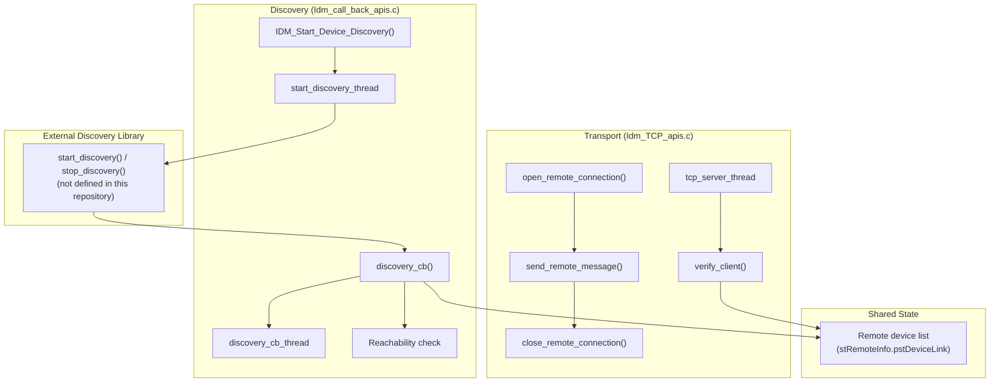

# Discovery and Transport

## Overview

The discovery and transport component finds other Inter Device Manager peers on the local network and carries messages between them. Discovery is implemented in `Idm_call_back_apis.c`. Transport is implemented in `Idm_TCP_apis.c`. Discovery and client verification use the device list and ARP helpers in `Idm_utils.c`.

For the system-level view, see [architecture/component-diagram.md](../architecture/component-diagram.md).

---

## Architecture

---

## Discovery

### Discovery Startup

`IDM_Start_Device_Discovery()` creates two threads:

- `IDM_Incoming_req_handler_thread`, which handles incoming requests. See [message-processing.md](message-processing.md).
- `start_discovery_thread`, which runs discovery.

### Discovery Thread

`start_discovery_thread` runs the following steps.

1. It waits 500 ms using `select`.
2. It calls `IDM_UpdateLocalDeviceData()`. If the call returns `ANSC_STATUS_DO_IT_AGAIN`, the thread logs "IDM Restart triggered" and repeats the step.
3. It fills a `discovery_config_t` with the following values:
   - the SSL certificate, key, and CA paths
   - `discovery_interval`, derived from `HelloInterval` (milliseconds converted to seconds)
   - `loss_detection_window`, derived from `DetectionWindow` (milliseconds converted to seconds)
   - the interface name and port
4. It restarts the firewall by calling `sysevent_set()` with `SYSEVENT_FIREWALL_RESTART`.
5. It calls `start_discovery(&discoveryConf, discovery_cb)`. This call does not return until discovery stops.

`start_discovery()` and `stop_discovery()` are declared in `Idm_call_back_apis.c` but are not defined in this repository. The discovery protocol implementation is therefore outside the scope of this documentation.

### Discovery Callback

`discovery_cb()` is called by the discovery library with the discovered devices and a status value.

| Condition                                              | Behaviour                                                                 |
| ------------------------------------------------------ | ------------------------------------------------------------------------- |
| Status is 0 and the device is already `DEVICE_CONNECTED` | A reachability check is scheduled after 5 seconds                       |
| Status is 0 and the device is not yet connected        | The remote discovery status is updated                                    |
| A new device is found                                  | `discovery_cb_thread` is created to process it                            |
| A local device is detected                             | `xupnp_rediscover_thread` is created                                      |

Discovery results are matched to entries in the remote device list by MAC address. Entries are published through the data model. See [data-model-layer.md](data-model-layer.md).

---

## Transport

### Server Side

`tcp_server_thread` runs as follows.

1. It reads the IPv4 address of the configured interface with `SIOCGIFADDR`.
2. It creates a TCP `SOCK_STREAM` socket with `SO_REUSEADDR` set.
3. When `IDM_DEBUG` is not defined, it initializes OpenSSL, creates a context with `init_ctx()`, and loads the certificate with `load_certificate()`.
4. It binds to the interface address and the configured port, then listens.
5. For each accepted connection, it calls `verify_client()`.

`verify_client()` gets the ARP MAC address for the client IP with `getARPMac()`. It then searches the remote device list for a matching MAC and IPv4 address. The function retries up to 60 times, one second apart, while waiting for the client to be discovered. The retry limit is set in the source as `counter >= 60`.

### Client Side

`open_remote_connection()` starts the server thread once, controlled by the `TCP_server_started` flag. It then opens a TCP connection to the remote port and performs the TLS handshake when `IDM_DEBUG` is not defined.

`send_remote_message()` sends a payload over an established connection. `close_remote_connection()` closes it.

### Security Settings

| Setting                              | Source                                | Notes                                                                              |
| ------------------------------------ | ------------------------------------- | ---------------------------------------------------------------------------------- |
| TLS context method                   | `Idm_TCP_apis.c`, `init_ctx()`        | Uses `SSLv23_method()`, a legacy method that negotiates the highest version the peer supports. Newer TLS-only methods are not used. |
| Client verification                  | `verify_client()`                     | Matches the client MAC and IPv4 address to the discovered device list               |
| TLS bypass                           | `#ifndef IDM_DEBUG` guards            | When `IDM_DEBUG` is defined, the server and client use plain sockets without TLS    |

---

## Integration Points

| Component                     | Interaction                                                                 |
| ----------------------------- | --------------------------------------------------------------------------- |
| Message processing            | Incoming requests and outgoing payloads. See [message-processing.md](message-processing.md). |
| Data model layer              | Device list and connection settings. See [data-model-layer.md](data-model-layer.md). |
| Configuration                 | `HelloInterval`, `DetectionWindow`, interface, port, and certificate paths. See [configuration-guide.md](../configuration-guide.md). |
| sysevent                      | Firewall restart request                                                    |

---

## Error Handling

| Condition                                    | Behaviour                                                                 |
| -------------------------------------------- | ------------------------------------------------------------------------- |
| `IDM_UpdateLocalDeviceData()` returns `ANSC_STATUS_DO_IT_AGAIN` | The step is retried after logging "IDM Restart triggered"  |
| TLS context creation fails                   | The server thread logs the error and returns                              |
| Certificate loading fails                    | The server thread frees the context, closes the socket, and returns       |
| `bind()` or `listen()` fails                 | The server thread frees the context, closes the socket, and returns       |
| Client is not found in the device list       | `verify_client()` returns 0 after the retry loop ends                     |

---

## Notes

- UDP sockets (`SOCK_DGRAM`) are used only for interface ioctl queries such as `SIOCGIFADDR` and ARP lookups. Message transport uses TCP sockets (`SOCK_STREAM`). Discovery traffic is handled by the external library.
- The TCP server listens only on the configured interface address.
- Several send and receive paths in `Idm_TCP_apis.c` and `Idm_msg_process.c` are guarded by `#ifndef IDM_DEBUG`. Defining `IDM_DEBUG` disables TLS and uses plain sockets. See [configuration-guide.md](../configuration-guide.md#compile-time-macros).
