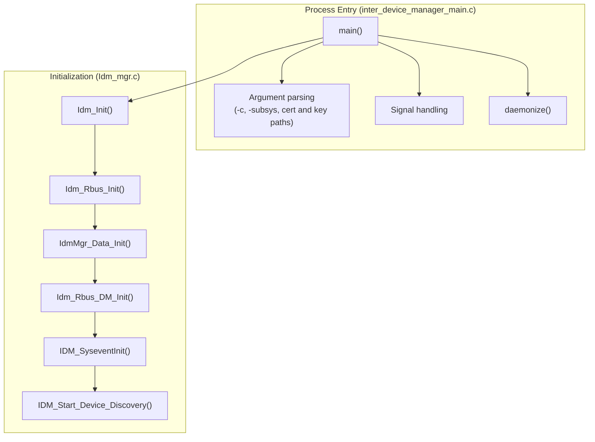

# Main and Initialization

## Overview

The main and initialization component is the entry point of the Inter Device Manager process. It is implemented in `inter_device_manager_main.c` and `Idm_mgr.c`. It parses command-line arguments, prepares the process (logging, privilege reduction, daemonization, and signal handling), and then starts the subsystems in a fixed order through `Idm_Init()`.

For the system-level view, see [architecture/component-diagram.md](../architecture/component-diagram.md).

---

## Architecture

---

## Key Components

| Function                          | Source file                       | Purpose                                                                                 |
| --------------------------------- | --------------------------------- | --------------------------------------------------------------------------------------- |
| `main()`                          | `inter_device_manager_main.c`     | Process entry point; sequences setup, initialization, and the run loop                  |
| `daemonize()`                     | `inter_device_manager_main.c`     | Runs the process in the background unless foreground mode (`-c`) is selected            |
| Signal handler                    | `inter_device_manager_main.c`     | Exits on `SIGINT`; prints a backtrace and exits on other handled signals                |
| `Idm_Init()`                      | `Idm_mgr.c`                       | Starts the subsystems in order and returns failure if an essential step fails           |
| `Idm_Rbus_Init()`                 | `Idm_rbus.c`                      | Opens the rbus handle for component `IDM_RBUS`                                          |
| `IdmMgr_Data_Init()`              | `Idm_data.c`                      | Initializes the shared configuration from PSM and factory defaults                      |
| `Idm_Rbus_DM_Init()`              | `Idm_rbus.c`                      | Registers the data model elements                                                       |
| `IDM_SyseventInit()`              | `Idm_utils.c`                     | Initializes sysevent support                                                            |
| `IDM_Start_Device_Discovery()`    | `Idm_call_back_apis.c`            | Starts the discovery and incoming request threads                                       |

---

## Startup Flow

1. `main()` initializes the RDK logger when `FEATURE_SUPPORT_RDKLOG` is defined.
2. `main()` drops root capabilities. This runs unconditionally; no `#ifdef` guards it.
3. `main()` parses arguments. Arguments are described in [configuration-guide.md](../configuration-guide.md#command-line-arguments).
4. Unless `-c` is given, `daemonize()` runs the process in the background.
5. Signal handlers are installed.
6. `main()` creates the marker file `/tmp/interdevicemanager_initialized`.
7. `Idm_Init()` runs the steps in this order:
   1. `Idm_Rbus_Init()`
   2. `IdmMgr_Data_Init()`
   3. `Idm_Rbus_DM_Init()`
   4. `IDM_SyseventInit()`
   5. `IDM_Start_Device_Discovery()`
8. When the process is daemonized, `main()` runs a loop that sleeps for 30 seconds at a time.

---

## Error Handling

| Condition                                  | Behaviour                                                                                  |
| ------------------------------------------ | ------------------------------------------------------------------------------------------ |
| `Idm_Rbus_Init()` fails                    | `Idm_Init()` returns failure                                                               |
| `IdmMgr_Data_Init()` fails                 | `Idm_Init()` returns failure                                                               |
| `Idm_Rbus_DM_Init()` fails                 | `Idm_Init()` returns failure                                                               |
| `IDM_SyseventInit()` fails                 | The sysevent handle is closed and `Idm_Init()` returns failure                             |
| `IDM_Start_Device_Discovery()` fails       | The failure is logged. `Idm_Init()` continues.                                             |
| `Idm_Init()` returns failure in `main()`   | `main()` logs the error and continues to the run loop                                      |
| `SIGINT` received                          | The process exits                                                                          |
| Other handled signal received              | A backtrace is printed and the process exits                                               |

---

## Notes

- The marker file `/tmp/interdevicemanager_initialized` is created before `Idm_Init()` runs, so it indicates that the process reached the initialization stage, not that initialization succeeded.
- Some startup paths are compiled in only when a build option or macro is defined. See [configuration-guide.md](../configuration-guide.md#compile-time-macros).
