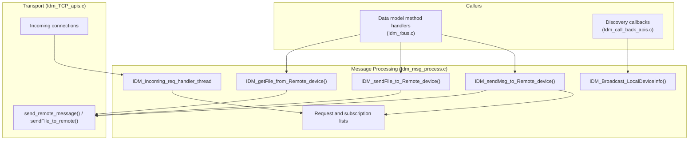

# Message Processing

## Overview

The message processing component builds, sends, receives, and tracks messages exchanged between Inter Device Manager peers. It is implemented mainly in `Idm_msg_process.c`, with dispatch in `Idm_call_back_apis.c`. Messages carry an operation code. The component handles three kinds of work: property get and set, subscriptions, and file transfer.

For the system-level view, see [architecture/component-diagram.md](../architecture/component-diagram.md).

---

## Architecture

---

## Operations

Each message carries one of the following operation codes.

| Operation     | Purpose                                                                 |
| ------------- | ----------------------------------------------------------------------- |
| `GET`         | Requests the value of a remote parameter                                |
| `SET`         | Sets a remote parameter                                                 |
| `IDM_REQUEST` | Sends a generic request, handled through the request path               |
| `IDM_SUBS`    | Creates or updates a subscription to a remote parameter                 |
| `GFT`         | Requests a file from a remote device (get file transfer)                |
| `SFT`         | Sends a file to a remote device (send file transfer)                    |
| `SFT_RES`     | Returns the result of a file transfer                                   |

Messages are also marked with a message type of `REQ` (request) or `RES` (response). Incoming messages are routed by `IDM_Incoming_req_handler_thread` and the callbacks in `Idm_call_back_apis.c`.

---

## Key Components

| Function                                      | Purpose                                                                                       |
| --------------------------------------------- | --------------------------------------------------------------------------------------------- |
| `IDM_sendMsg_to_Remote_device()`              | Sends a `GET`, `SET`, or `IDM_REQUEST` message to a remote device                             |
| `IDM_sendFile_to_Remote_device()`             | Sends a file to a connected remote device with the `SFT` operation                            |
| `IDM_getFile_from_Remote_device()`            | Requests a file from a connected remote device with the `GFT` operation                       |
| `IDM_Incoming_req_handler_thread`             | Thread that processes incoming requests and responses                                         |
| `IDM_Broadcast_LocalDeviceInfo()`             | Sends the local device information to the network                                             |
| `IDM_addToSendRequestList()`                  | Adds an outgoing request to the pending request list                                          |
| `IDM_getFromSendRequestList()`                | Retrieves a pending request                                                                   |
| `IDM_searchFromSendRequestList()`             | Searches the pending request list                                                             |

### Request Tracking

Outgoing requests are stored in a send request list until a response arrives. A resend reuses the same `reqId`.

### Subscriptions

`IDM_SUBS` messages are handled in `Idm_msg_process.c`, and subscriptions are kept in a linked list. The delivery path for subscribed value changes is not described in this document because it was not verified in source.

---

## Processing Flow

### Send Message

1. A data model method handler calls `IDM_sendMsg_to_Remote_device()`.
2. The outgoing request is added to the send request list.
3. The message is sent through the transport layer. See [discovery-and-transport.md](discovery-and-transport.md).
4. The pending request is handled when a matching response is processed.

### File Transfer

1. A data model method handler calls `IDM_sendFile_to_Remote_device()` or `IDM_getFile_from_Remote_device()`.
2. The function searches the remote device list for the target MAC address with status `DEVICE_CONNECTED`. If the device has a zero connection handle, the status is set to `FT_ERROR` and the function returns failure.
3. The `SFT` or `GFT` payload is sent with `sendFile_to_remote()`.
4. The returned status is copied into the file transfer status field and published as the `FileTransferStatus` event.
5. If the status is not `FT_SUCCESS`, the function returns failure.

If no connected device matches the target MAC, the status is set to `FT_INVALID_DST_MAC`.

### Incoming Message

1. `IDM_Incoming_req_handler_thread` receives an incoming message.
2. The message is routed by its message type and operation code. `SFT`, `SFT_RES`, and `GFT` are dispatched in `Idm_call_back_apis.c`.

---

## File Transfer

File transfer status values are defined in `Idm_rbus.h` and are published through the `Device.X_RDK_Remote.FileTransferStatus()` event.

| Status                     | Meaning                                                  |
| -------------------------- | -------------------------------------------------------- |
| `FT_SUCCESS`               | The transfer completed successfully                      |
| `FT_ERROR`                 | The transfer failed                                      |
| `FT_INVALID_SRC_PATH`      | The source path is not valid                             |
| `FT_INVALID_DST_PATH`      | The destination path is not valid                        |
| `FT_NOT_WRITABLE_PATH`     | The destination path is not writable                     |
| `FT_INVALID_DST_MAC`       | No connected device matches the destination MAC address  |
| `FT_INVALID_FILE_SIZE`     | The file size is not valid                               |
| `FT_FILE_SIZE_EXCEED`      | The file exceeds the maximum transfer size               |

The default maximum file size is 512000 bytes (`DEFAULT_MAX_FT_SIZE` in `Idm_data.c`).

---

## Integration Points

| Component                     | Interaction                                                                 |
| ----------------------------- | --------------------------------------------------------------------------- |
| Data model layer              | Method calls and events. See [data-model-layer.md](data-model-layer.md).    |
| Discovery and transport       | Peer lookup and message delivery. See [discovery-and-transport.md](discovery-and-transport.md). |
| Configuration                 | Maximum file size and device list. See [configuration-guide.md](../configuration-guide.md). |

---

## Error Handling

| Condition                                       | Behaviour                                                                 |
| ----------------------------------------------- | ------------------------------------------------------------------------- |
| Configuration cannot be locked                  | The function returns `ANSC_STATUS_FAILURE`                                |
| No connected device matches the target MAC      | The status is set to `FT_INVALID_DST_MAC`                                 |
| Connection handle is zero                       | The status is set to `FT_ERROR` and the function returns failure          |
| Transfer status is not `FT_SUCCESS`             | The function returns failure                                              |

---

## Notes

- Several send and receive paths in this file are guarded by `#ifndef IDM_DEBUG`. Defining `IDM_DEBUG` disables those paths. See [configuration-guide.md](../configuration-guide.md#compile-time-macros).
