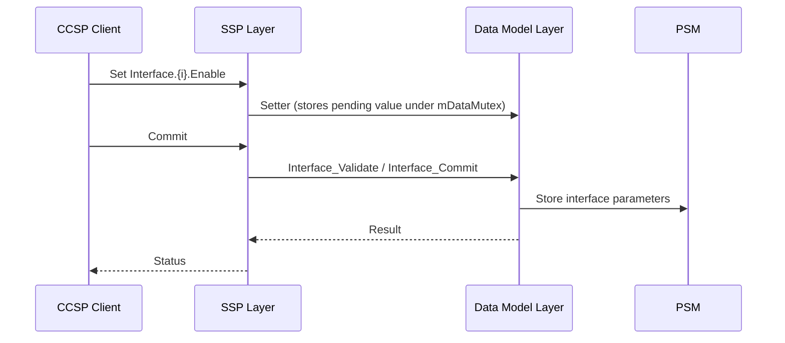
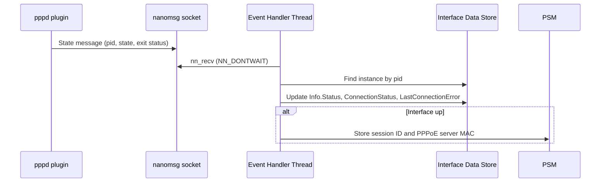
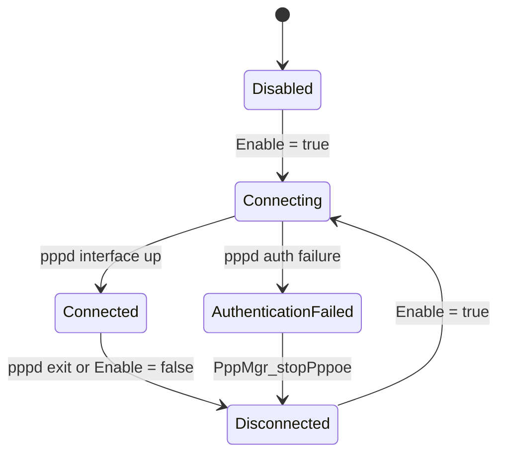

# Component Architecture

## Overview

PPP Manager runs as a single CCSP component process. The process registers the TR-181 `Device.PPP` data model with the Component Registry, handles get, set, validate, commit, and rollback requests through the data model layer, and controls PPP sessions through `pppd` and its plugins. Plugins report session state back to the process over nanomsg.

## System Context

```mermaid
graph TB
    subgraph External["External Entities"]
        CCSP[CCSP Message Bus<br/>and Component Registry]
        PPPD[pppd with rp-pppoe / pppoatm plugins]
        PSM[PSM Database]
        SYS[sysevent / syscfg]
        PROC[/proc/net/pppoe, /proc/net/dev]
    end

    subgraph PPPMgr["PPP Manager (pppmanager)"]
        SSP[SSP Layer]
        DML[TR-181 Data Model Layer]
        IPC[IPC Layer]
        CTRL[PPP Session Control]
    end

    CCSP <-->|TR-181 requests| SSP
    SSP --> DML
    DML --> CTRL
    CTRL -->|start and stop| PPPD
    PPPD -->|state messages<br/>nanomsg PUSH| IPC
    IPC --> DML
    DML <-->|parameter persistence| PSM
    DML --> SYS
    DML --> PROC
```

## High-Level Architecture

The component has four layers:

| Layer | Responsibility | Main sources |
|-------|----------------|--------------|
| SSP | Process startup, CCSP registration, message bus setup, signal handling | `source/PppManager/` |
| TR-181 Data Model | Parameter handlers, interface data store, PSM persistence | `source/TR-181/middle_layer_src/pppmgr_dml*.c` |
| IPC | nanomsg server, POSIX queue consumer, pppd state mapping | `source/PppManager/pppmgr_ipc.c` |
| PPP Session Control | Starting and stopping PPP clients, statistics | `source/TR-181/middle_layer_src/pppmgr_dml_ppp_apis.c` |

## Threading Model

PPP Manager uses the following execution contexts:

| Context | Created by | Role |
|---------|------------|------|
| Main thread | `main()` | Runs the daemon loop, or the console loop with `-c` |
| CCSP message bus callbacks | CCSP bus library | Handle TR-181 get, set, and commit requests |
| Event handler thread | `PppMgr_StartIpcServer()` | Polls the nanomsg socket and the `/pppmgr_queue` POSIX queue every 500 ms |

Access to each interface's configuration and state is serialized with a per-instance recursive mutex (`mDataMutex`). Both the event handler thread and the data model callbacks take this lock through `PppMgr_GetIfaceData_locked()` and release it through `PppMgr_GetIfaceData_release()`.

## Data Flow

### Parameter Set and Commit



### PPP State Change



## Message Flow

```mermaid
flowchart LR
    A[pppd plugin] -->|nanomsg PUSH| B[PPP_MANAGER_ADDR<br/>NN_PULL server]
    C[Internal code] -->|mq_send| D[/pppmgr_queue]
    B --> E[PppMgr_EventHandlerThread]
    D --> E
    E --> F{Message type}
    F -->|State change| G[PppMgr_ProcessStateChangedMsg]
    F -->|IPCP or IPv6CP| H[PppMgr_ProcessPppState]
    F -->|Start event| I[PPP start handling]
```

## State Management

Each interface reports two state fields:

- `Status` (`Info.Status`): Interface state, one of Up, Down, Unknown, Dormant, NotPresent, LowerLayerDown, or Error.
- `ConnectionStatus`: Session state, one of Unconfigured through AuthenticationFailed.



The state names above are simplified. See the [PPP Session Control](../components/ppp-session-control.md) document for the exact enum values.

## Error Recovery

| Condition | Detection | Response |
|-----------|-----------|----------|
| `pppd` exits with status 5 | State message from plugin | `LastConnectionError` = `ERROR_USER_DISCONNECT` |
| `pppd` exits with status 11 or 19 | State message from plugin | `LastConnectionError` = `ERROR_AUTHENTICATION_FAILURE` |
| `pppd` exits with status 16 | State message from plugin | `LastConnectionError` = `ERROR_ISP_TIME_OUT` |
| Any other exit status | State message from plugin | `LastConnectionError` = `ERROR_UNKNOWN` |
| Authentication failure | `AUTH_FAILED` state | `PppMgr_stopPppoe()` is called |
| Process already running | `PppMgr_checkPidExist()` | Start request is not repeated |

## Security Architecture

- The nanomsg server listens on the address defined by `PPP_MANAGER_ADDR`. That macro is defined in an external header (`ipc_msg.h`) that is not part of this repository.
- The `sysevent` connection is opened to `127.0.0.1` only.
- Usernames are checked against the pattern `^[a-zA-Z0-9_#-.@]*$` before use.
- Credentials are stored in PSM only when the build defines `PPP_USERNAME_PASSWORD_FROM_PSM`.

## Build Variants

| Option or macro | Set by | Effect |
|-----------------|--------|--------|
| `--enable-notify` | `configure.ac` | Defines `ENABLE_SD_NOTIFY` and links `-lsystemd` |
| `--enable-dropearly` | `configure.ac` | Defines `DROP_ROOT_EARLY` |
| `_USE_NM_MSG_SOCK` | `source/PppManager/Makefile.am` | Always defined for `pppmanager` |
| `USE_PPP_DAEMON` | Source only | Launches `pppd` directly instead of through `pppoe-start` |
| `DUID_UUID_ENABLE` | Source only | Generates a DUID file from the `UUID` syscfg value |
| `PPP_USERNAME_PASSWORD_FROM_PSM` | Source only | Adds username and password PSM keys |

Macros marked "Source only" are not set by any file in this repository and must be defined by the platform build when used.
