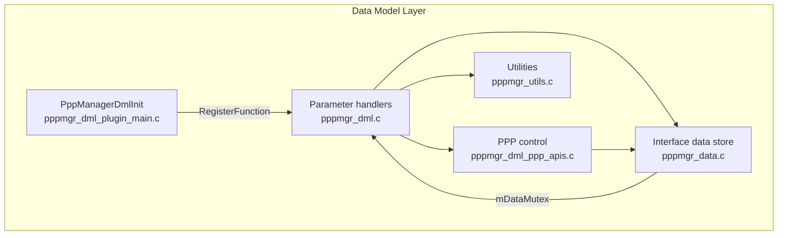
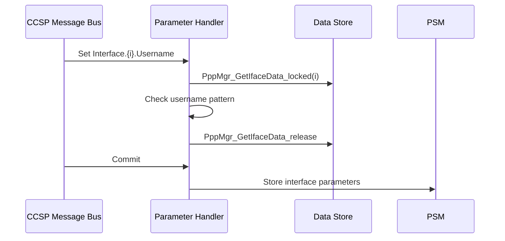

# Data Model Layer

## Overview

The data model layer implements the TR-181 `Device.PPP` object. It registers parameter handlers with the CCSP runtime, keeps the interface data store, and persists selected settings in PSM. Requests from the message bus and state updates from the IPC layer both work on this data store.

## Architecture



## Files

| File | Role |
|------|------|
| `pppmgr_dml_plugin_main.c` | Registers all TR-181 handlers with `RegisterFunction` |
| `pppmgr_dml.c` / `pppmgr_dml.h` | Parameter get, set, validate, commit, and rollback handlers; PSM key macros and enumerations |
| `pppmgr_data.c` / `pppmgr_data.h` | Interface data store and instance-to-index mapping |
| `pppmgr_dml_ppp_apis.c` / `pppmgr_dml_ppp_apis.h` | Start and stop logic and statistics |
| `pppmgr_utils.c` / `pppmgr_utils.h` | syscfg and sysevent access and DUID generation |

## Core Functions

### PppManagerDmlInit

**Purpose**: Registers the TR-181 handlers.

**Processing**: Calls `RegisterFunction` for the `Interface_Validate`, `Interface_Commit`, and `Interface_Rollback` handlers, the `PPPoE_*`, `IPCP_*`, and `IPv6CP_*` handlers, and the `Stats_GetParamUlongValue` handler. Acquires `COSAValidateHierarchyInterface`.

### Interface Parameter Handlers

**Purpose**: Get and set `Device.PPP.Interface.{i}.*` parameters.

**Processing**:
- Setters take `mDataMutex` for the target instance before changing the value.
- Commit applies the pending values through `Interface_Commit`.
- Rollback restores the previous values through `Interface_Rollback`.

`LastConnectionError` is returned from the value stored by the IPC layer.

### PppMgr_GetIfaceData_locked

**Purpose**: Returns the data entry for an instance, with its lock held.

**Inputs**: Instance number `N`.

**Processing**: Maps `N` to table index `N - 1` and locks the entry's `mDataMutex`. The caller releases it with `PppMgr_GetIfaceData_release`.

### PppDmlGetIntfValuesFromPSM

**Purpose**: Loads interface settings from PSM at startup.

**Processing**: Reads the `dmsb.pppmanager.*` keys listed in the [Configuration Guide](../configuration-guide.md#persistent-storage-keys). Initializes the recursive mutexes used for each entry.

### Platform value access (pppmgr_utils.c)

**Purpose**: Reads platform values from syscfg and sysevent.

**Processing**: Reads `wan_proto` from syscfg and `SYSEVENT_PPP_STATUS` from sysevent. When `DUID_UUID_ENABLE` is defined, `PppMgr_GenerateDuidFile` reads `UUID` from syscfg and writes a DUID file through `popen`.

## Data Structures

The per-interface entry is `DML_PPP_IF_FULL`, defined in `pppmgr_dml.h`. Its `Cfg` member holds configuration values, its `Info` member holds runtime state, and `mDataMutex` is its recursive lock.

```c
/* Example only: fields referenced in the source, not a complete definition */
pEntry->Cfg.Username
pEntry->Cfg.Password
pEntry->Info.LCPEcho
pEntry->mDataMutex
```

Enumerations are defined in `pppmgr_dml.h`:

| Enumeration | Values |
|-------------|--------|
| Link type | PPPoA (1), PPPoE (2) |
| Connection status | Unconfigured through AuthenticationFailed |
| Interface status | Up, Down, Unknown, Dormant, NotPresent, LowerLayerDown, Error |
| Last connection error | 23 values |
| Authentication protocol | PAP, CHAP, MS_CHAP, AUTO |

## Processing Flow



## State Management

The data store holds the values that the handlers return. Two groups of fields have separate writers:

| Field group | Writer |
|-------------|--------|
| `Cfg` (Enable, Username, Password, and related fields) | Parameter setters through the message bus |
| `Info` (`Status`, `ConnectionStatus`, `LastConnectionError`) | IPC event handler |

Both writers take `mDataMutex`.

## Integration Points

| Component | Interaction |
|-----------|-------------|
| CCSP message bus | Handler registration and parameter access |
| IPC layer | Updates `Info` fields and reads `pid` to find the instance |
| PPP session control | Starts and stops sessions on `Enable` changes |
| PSM | Persists configuration and session ID |
| syscfg, sysevent | Platform values (`wan_proto`, `UUID`, `SYSEVENT_PPP_STATUS`) |

## Configuration

The data model definition is in `config/RdkPppManager.xml`. Parameter names and types are listed in the [Configuration Guide](../configuration-guide.md#tr-181-parameter-reference).

## Error Handling

| Condition | Response |
|-----------|----------|
| Username does not match `^[a-zA-Z0-9_#-.@]*$` | Value is rejected by validation |

## Performance

Each lock covers a single interface entry, so operations on different instances do not block each other. The table holds up to 128 entries.
