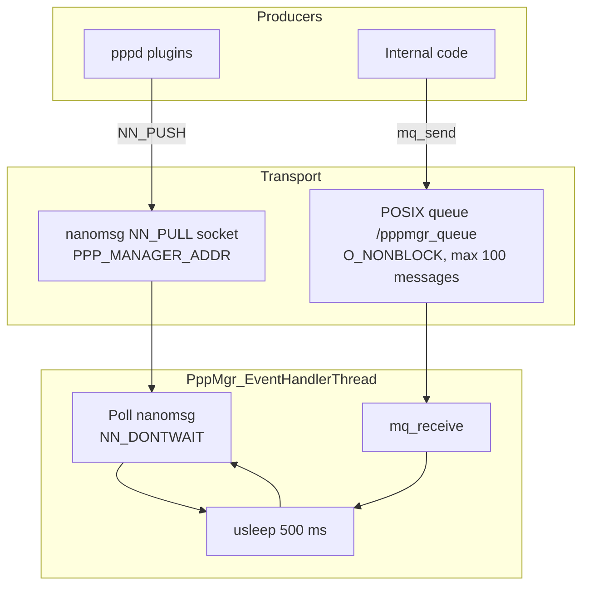
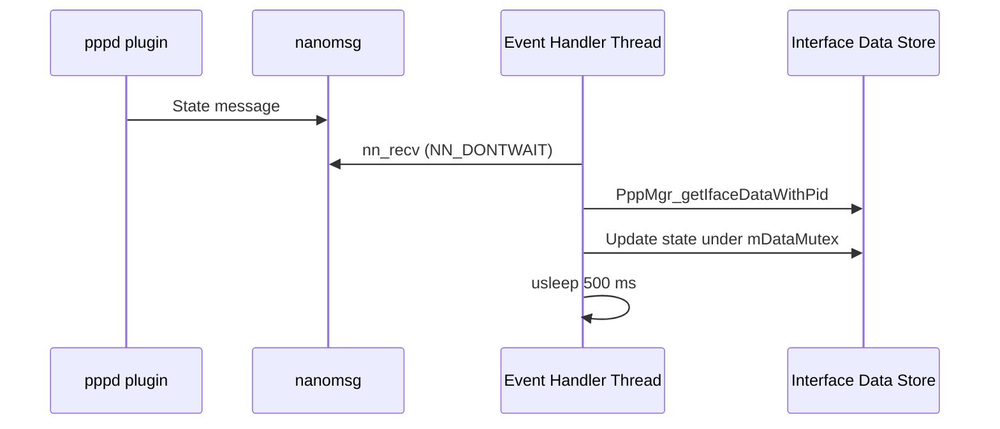

# IPC Layer

## Overview

The IPC layer receives PPP session events and updates the TR-181 interface state. `pppd` plugins send state messages over a nanomsg socket. Events generated inside the process are passed through a POSIX message queue. A single event handler thread drains both sources.

## Architecture

## Files

| File | Role |
|------|------|
| `source/PppManager/pppmgr_ipc.c` | Socket and queue setup, event thread, state mapping |

## Core Functions

### PppMgr_Init

**Purpose**: Starts IPC handling at process startup.

**Processing**:
1. Calls `PppMgr_StartIpcServer()`.
2. Opens sysevent on `127.0.0.1` with the name `pppmgr`.

### PppMgr_StartIpcServer

**Purpose**: Creates the nanomsg server socket and the event handler thread.

**Processing**: Creates an `AF_SP` `NN_PULL` socket bound to `PPP_MANAGER_ADDR`. Starts `PppMgr_EventHandlerThread` with `pthread_create`.

`PPP_MANAGER_ADDR` is defined in `ipc_msg.h`, which is not part of this repository.

### PppMgr_EventHandlerThread

**Purpose**: Dispatches incoming events while the process is running.

**Processing**: Loops while `bRunning` is set:
1. Calls `nn_recv` on the server socket with `NN_DONTWAIT`.
2. Calls `mq_receive` on `/pppmgr_queue` with `O_NONBLOCK`.
3. Sleeps for 500 ms with `usleep(500000)`.

### PppMgr_ProcessStateChangedMsg

**Purpose**: Maps `pppd` state messages to interface fields.

**Processing**:

| Received state | Action |
|----------------|--------|
| `PPP_INTERFACE_UP` | Clears `LastConnectionError`, reads the session ID, and writes it to PSM. For PPPoE, reads `/proc/net/pppoe` and writes the server MAC to `/nvram/last_ppp_session` |
| `DISCONNECTED` or `DOWN` | Maps the `pppd` exit status to `LastConnectionError` (see table below) |
| `AUTH_FAILED` | Calls `PppMgr_stopPppoe()` |

**Exit status mapping**:

| Exit status | `LastConnectionError` |
|-------------|------------------------|
| 5 | `ERROR_USER_DISCONNECT` |
| 11 or 19 | `ERROR_AUTHENTICATION_FAILURE` |
| 16 | `ERROR_ISP_TIME_OUT` |
| Any other value | `ERROR_UNKNOWN` |

### PppMgr_ProcessPppState

**Purpose**: Handles IPCP and IPv6CP completion and failure events.

**Processing**: Finds the interface instance for the reporting process ID with `PppMgr_getIfaceDataWithPid`, then updates the IPCP or IPv6CP state for that instance.

### PppMgr_SendDataToQ and PppMgr_SendPppdStartEventToQ

**Purpose**: Queue internal events for the event handler thread.

**Processing**: Send a `PPPEventQData` message to `/pppmgr_queue`. The queue message size is `sizeof(PPPEventQData)`.

## Data Structures

`PPPEventQData` is the message type for the POSIX queue. Its definition is in `pppmgr_ipc.c`.

## Processing Flow

## State Management

The IPC layer does not keep its own state machine. It updates the interface state that the data model layer reports. The state values are described in the [Architecture document](../architecture/component-diagram.md#state-management).

## Integration Points

| Component | Interaction |
|-----------|-------------|
| `pppd` plugins | Send state messages to `PPP_MANAGER_ADDR` |
| Data model layer | Reads and updates interface data under `mDataMutex` |
| PSM | Writes session ID on `PPP_INTERFACE_UP` (see [Configuration Guide](../configuration-guide.md#known-issues)) |
| sysevent | Used for `SYSEVENT_PPP_STATUS` reads |
| `/proc/net/pppoe` | Read for PPPoE server MAC on `PPP_INTERFACE_UP` |

## Configuration

| Item | Value |
|------|-------|
| nanomsg address | `PPP_MANAGER_ADDR` (external header) |
| Queue name | `/pppmgr_queue` |
| Queue capacity | `MAX_QUEUE_LENGTH` = 100 |
| Poll interval | 500 ms |

## Error Handling

| Condition | Response |
|-----------|----------|
| Receive returns no message | Loop continues on the next poll |
| Unknown exit status | `LastConnectionError` = `ERROR_UNKNOWN` |
| Authentication failure | `PppMgr_stopPppoe()` is called |

## Performance

Events are handled with up to 500 ms of latency because the thread sleeps between polls. The queue holds up to 100 messages.
