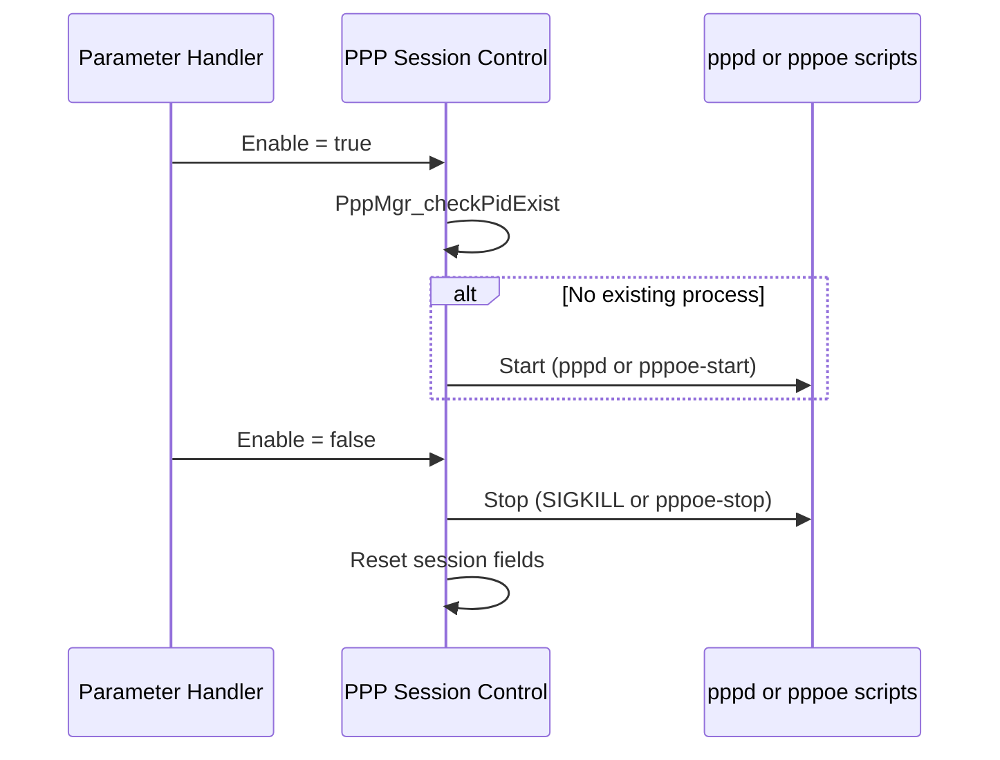

# PPP Session Control

## Overview

PPP session control starts and stops `pppd` sessions for each interface. It is called from the TR-181 handlers when `Enable` changes, and it also collects per-interface statistics. The default build uses PPPoE helper scripts. A build with `USE_PPP_DAEMON` defined starts and stops `pppd` directly.

## Architecture

```mermaid
graph TB
    DML[Parameter handlers] -->|Enable change| START[PppMgr_StartPppClient]
    DML -->|Enable change| STOP[PppMgr_StopPppClient]
    START --> CHK[PppMgr_checkPidExist]
    START -->|USE_PPP_DAEMON| PPPD[pppd with plugin]
    START -->|default| SCRIPT[pppoe_config.sh<br/>pppoe-start]
    STOP -->|USE_PPP_DAEMON| KILL[kill SIGKILL]
    STOP -->|default| PSTOP[pppoe-stop]
    STATS[CosaUtilGetIfStats] --> PROC[/proc/net/dev_extstats<br/>or /proc/net/dev]
```

## Files

| File | Role |
|------|------|
| `pppmgr_dml_ppp_apis.c` | Start, stop, process checks, and statistics |
| `pppmgr_dml_ppp_apis.h` | Function declarations |

## Core Functions

### PppMgr_StartPppClient

**Purpose**: Starts a PPP session for an interface.

**Inputs**: Interface instance data, including `Username`, `Password`, `LCPEcho`, `LCPEchoRetry`, `Name`, and the PPPoE service name.

**Processing**:
1. Calls `PppMgr_checkPidExist`. If a `pppd` process already exists for the interface, the start request is not repeated.
2. Selects the branch from the link type:
   - **PPPoE**: Builds the `pppd` arguments with `rp-pppoe.so`, or runs `pppoe_config.sh` followed by `/usr/sbin/pppoe-start` in the default build.
   - **PPPoA**: Builds the `pppd` arguments with `pppoatm.so`.
3. A PPPoE PADT path runs `pppoe -I <interface> -k`.

Plugin paths are hard-coded: `/usr/lib/pppd/2.4.9/rp-pppoe.so` and `pppoatm.so`.

### PppMgr_StopPppClient

**Purpose**: Stops the PPP session for an interface.

**Processing**:
1. Sets `bEnabled` to false.
2. Stops the process:
   - With `USE_PPP_DAEMON`: sends `SIGKILL` to the stored process ID through `PppMgr_stopPppProcess`.
   - Otherwise: runs `/usr/sbin/pppoe-stop` through `PppMgr_stopPppoe`.
3. Resets the session fields and sets IPCP and IPv6CP to down.

### PppMgr_checkPidExist

**Purpose**: Checks whether a `pppd` process is running.

**Processing**: Runs `ps` and filters for `pppd` through `popen`.

### PppDmlGetIntfValuesFromPSM

**Purpose**: Loads interface values from PSM. This is also where the recursive mutexes are initialized. See [Data Model Layer](./data-model-layer.md).

### CosaUtilGetIfStats

**Purpose**: Reads interface counters for the `Stats` object.

**Processing**: Reads `/proc/net/dev_extstats` if it exists. Otherwise reads `/proc/net/dev`.

## Data Structures

Session state is kept in the interface entry described in [Data Model Layer](./data-model-layer.md#data-structures). The `Info` fields that session control updates include the PPPoE session fields and the IPCP and IPv6CP state.

## Processing Flow



## State Management

Session control sets `bEnabled` and the IPCP and IPv6CP states. The IPC layer sets the connection status and error values, based on messages from `pppd`. See the [Architecture document](../architecture/component-diagram.md#state-management).

## Integration Points

| Component | Interaction |
|-----------|-------------|
| Parameter handlers | Call start and stop on `Enable` changes |
| `pppd` and its plugins | Started, and reporting state back through the IPC layer |
| `/usr/sbin/pppoe-start`, `pppoe-stop`, `pppoe_config.sh` | Used in the default build |
| `/proc/net/dev`, `/proc/net/dev_extstats` | Statistics source |

## Configuration

| Item | Value |
|------|-------|
| `pppd` plugin directory | `/usr/lib/pppd/2.4.9/` |
| Build flag for direct `pppd` start | `USE_PPP_DAEMON` (source only) |
| LCP echo defaults | `LCPEcho` 30, `LCPEchoRetry` 3 |

## Error Handling

| Condition | Response |
|-----------|----------|
| `pppd` already running | Start is not repeated |
| `pppd` exits | State is reported through the IPC layer and mapped to `LastConnectionError` |
| Authentication failure | `PppMgr_stopPppoe()` is called |

## Performance

Start and stop run external commands (`pppoe-start`, `pppoe-stop`, `ps`) through `system` or `popen`. These calls block the calling handler until the command returns.
