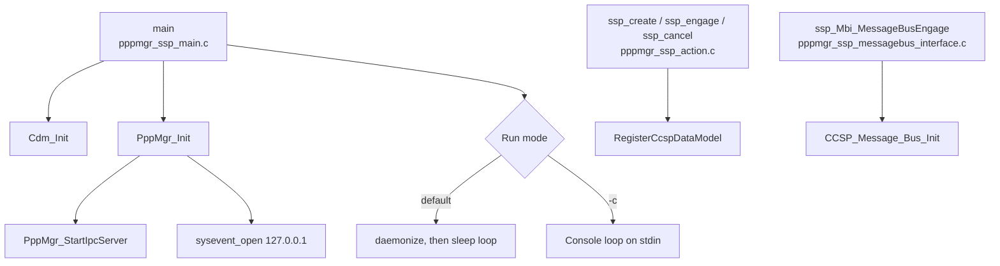
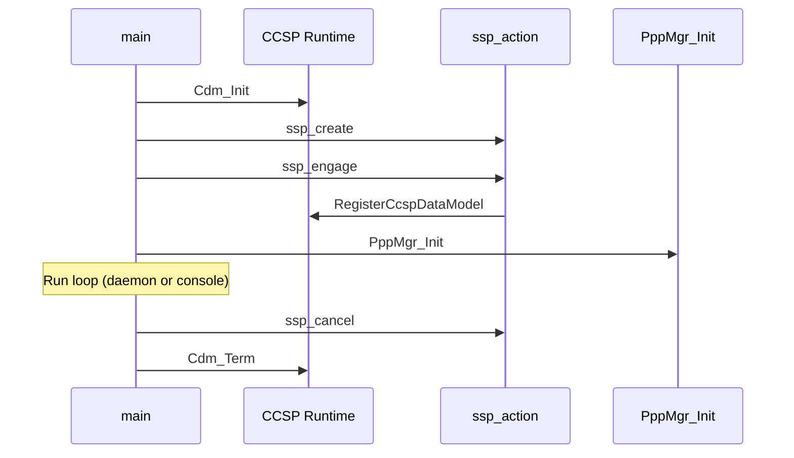
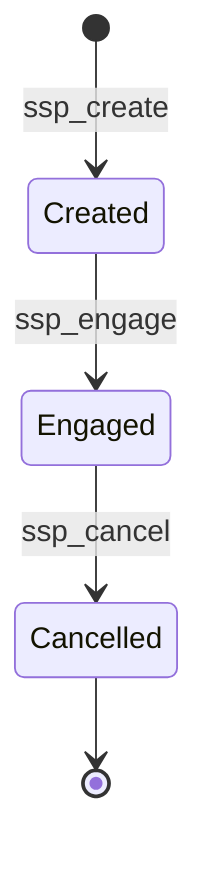

# SSP Layer

## Overview

The SSP (Service Start-up Platform) layer is the process entry point for `pppmanager`. It parses command-line options, starts the CCSP runtime, registers the TR-181 data model, and hands control to the data model and IPC layers.

## Architecture

## Files

| File | Role |
|------|------|
| `pppmgr_ssp_main.c` | `main()`, command-line parsing, signal handlers, process lifecycle |
| `pppmgr_ssp_action.c` | Component creation, engagement, and cancellation |
| `pppmgr_ssp_messagebus_interface.c` | CCSP message bus initialization and callback wiring |
| `pppmgr_global.h` | Component ID, component path, and shared includes |

## Core Functions

### main

**Purpose**: Starts the `pppmanager` process.

**Inputs**: Command-line options.

| Option | Effect |
|--------|--------|
| `-subsys <name>` | Parsed by `main()` and passed to the CCSP runtime |
| `-c` | Runs in console mode, reading commands from stdin |
| (none) | Runs as a daemon |

**Processing**:
1. Parses `-subsys` and `-c`.
2. Installs signal handlers for SIGTERM, SIGINT, SIGUSR1, SIGUSR2, SIGSEGV, and others.
3. Calls `Cdm_Init`.
4. Calls `PppMgr_Init()` to start the IPC server and open sysevent.
5. Enters the run loop. In daemon mode, the process calls `daemonize()` and then sleeps in a 30-second loop.
6. On exit, calls `Cdm_Term` and `ssp_cancel`.

### ssp_create

**Purpose**: Allocates the component state.

**Processing**: Sets up the CCD and LCB interfaces. The LCB library initializer is `PppManagerDmlInit`, which registers the TR-181 handlers. Calls `DslhCreateCpeController`.

The `Author` field is set to the template placeholder value. See [Configuration Guide: Known Issues](../configuration-guide.md#known-issues).

### ssp_engage

**Purpose**: Connects the component to the message bus and registers the data model.

**Processing**:
1. Attaches the MBI and CCD interfaces.
2. Calls `RegisterCcspDataModel` with `DATAMODEL_XML_FILE` set to `/usr/rdk/pppmanager/RdkPppManager.xml`.

### ssp_cancel

**Purpose**: Unregisters the component and frees its state.

### ssp_Mbi_MessageBusEngage

**Purpose**: Initializes the CCSP message bus.

**Processing**: Calls `CCSP_Message_Bus_Init` and wires the `CcspCcMbi_*` callbacks. It also registers the `currentSessionIDSignal` event.

## Data Structures

The component state is allocated in `ssp_create` and holds the CCD and LCB interface handles. The state is not defined in this repository.

## Processing Flow

## State Management

## Integration Points

| Component | Interface |
|-----------|-----------|
| CCSP Component Registry | `RegisterCcspDataModel` with the TR-181 XML |
| CCSP message bus | `CCSP_Message_Bus_Init` and `CcspCcMbi_*` callbacks |
| Data model layer | `PppManagerDmlInit` and the `RegisterFunction` table |
| IPC layer | `PppMgr_Init` |
| sysevent | `sysevent_open` on `127.0.0.1` with name `pppmgr` |

## Configuration

| Item | Value |
|------|-------|
| Component ID | `com.cisco.spvtg.ccsp.pppmanager` |
| Component path | `/com/cisco/spvtg/ccsp/pppmanager` |
| Data model file | `/usr/rdk/pppmanager/RdkPppManager.xml` |
| Build linkage | `-lccsp_common -ldl -lrdkloggers -lhal_platform -lnanomsg -lrt` |

## Error Handling

| Condition | Response |
|-----------|----------|
| `Cdm_Init` fails | Error is reported through the error variable. The message printed uses `Cdm_StrError(err)` after `err` is reused, so the text may not match the original failure |
| Termination signal received | Signal handler is installed. Shutdown runs `Cdm_Term` and `ssp_cancel` |

## Performance

In daemon mode, the main loop sleeps for 30 seconds per iteration. The IPC thread described in [IPC Layer](./ipc.md) polls every 500 ms and is the main periodic activity.
