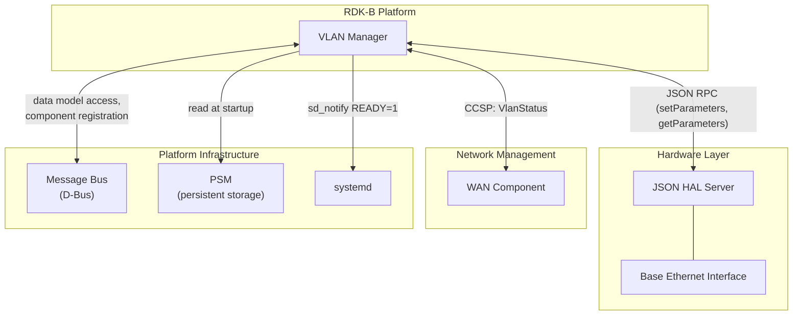
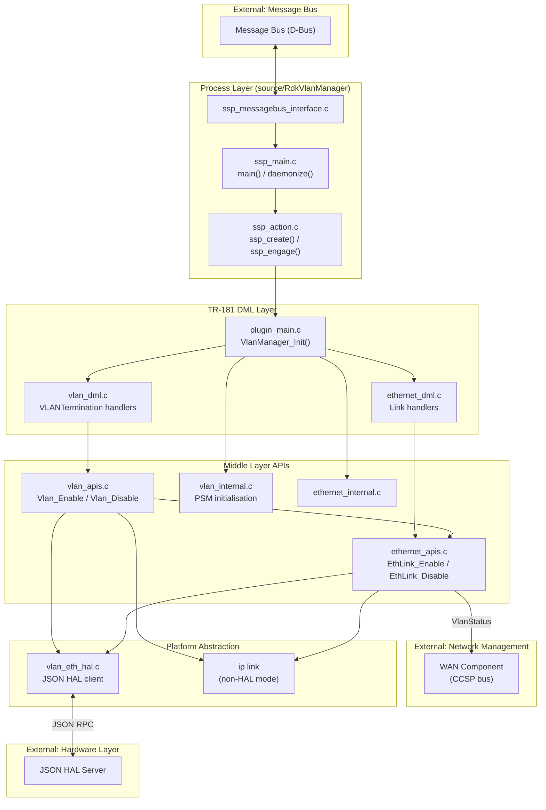
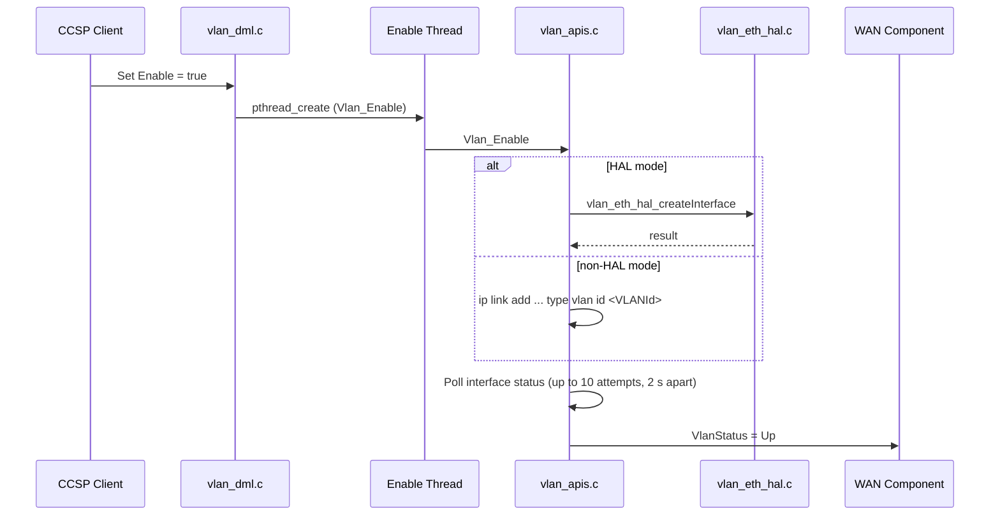

# VLAN Manager Architecture

## Component Overview

VLAN Manager is the RDK-B data model provider for VLAN interfaces. It is structured as a layered system: a process management layer (SSP), a TR-181 data model layer (DML) with its API and internal modules, and a platform layer that creates VLAN interfaces either through a JSON HAL server or through Linux networking commands.

---

## System Context

This diagram shows VLAN Manager as a black box and its relationships with external systems.

### External Dependencies

| System                  | Interface                          | Notes                                                                   |
| ----------------------- | ---------------------------------- | ----------------------------------------------------------------------- |
| JSON HAL Server         | JSON RPC over TCP (`server_port`)  | Used when the HAL mode is enabled. Vendor-supplied                      |
| WAN component           | CCSP bus (`DmlEthSetParamValues`)  | Receives `<path>.VlanStatus` values `Up` and `Down`                     |
| Message Bus             | D-Bus (local)                      | Required for data model access by other components                      |
| PSM                     | PSM record query                   | Read at startup for `dmsb.vlanmanager.*` and `dmsb.vlanmanager.cfg.*`   |
| Linux networking        | `ip link`, `ioctl`                 | Used for VLAN creation and status when the HAL mode is not enabled      |
| systemd                 | `sd_notify`                        | Optional; requires the `--enable-notify` build option                   |

---

## High-Level Architecture

---

## Component Responsibilities

### Process Layer (`source/RdkVlanManager/`)

- Process entry point, daemon mode, PID file, and readiness marker.
- CCSP message bus engagement and component registration.
- Data model registration with the CCSP framework.

### DML Layer (`source/TR-181/middle_layer_src/`)

- `plugin_main.c` provides `VlanManager_Init()`, which the SSP layer uses as the library initialisation callback.
- `vlan_dml.c` implements `Device.X_RDK_Ethernet.VLANTermination.*` get and set handlers.
- `ethernet_dml.c` implements `Device.X_RDK_Ethernet.Link.*` get and set handlers.
- `vlan_internal.c` and `ethernet_internal.c` load persisted configuration at startup.

### API Layer

- `vlan_apis.c` creates and removes tagged VLAN interfaces and polls their status.
- `ethernet_apis.c` creates and removes untagged VLAN links, manages marking tables, runs the refresh path, and sends VLAN status to the WAN component.

### Platform Abstraction

- `vlan_eth_hal.c` is the JSON HAL client. It is compiled only when `VLAN_MANAGER_HAL_ENABLED` is defined.
- In non-HAL mode, interface operations use `ip link` commands.

---

## Threading Model

The SSP main thread handles message bus callbacks and the daemon loop. Parameter set handlers run in the caller's context, except where noted below.

| Operation                                      | Execution context                                 | Synchronisation                       |
| ---------------------------------------------- | ------------------------------------------------- | ------------------------------------- |
| Message bus callbacks and parameter handlers   | SSP main thread                                   | CCSP framework                        |
| `Enable` on `VLANTermination` (`Vlan_Enable`)  | Detached `pthread` running `Vlan_Enable`          | Recursive mutex `vlan_access_mutex`   |
| `Enable` on `VLANTermination` (`Vlan_Disable`) | Detached `pthread` running `Vlan_Disable`         | Recursive mutex `vlan_access_mutex`   |
| `Enable` on `Link` (`EthLink_Enable`/`Disable`) | Synchronous, in the set handler                   | None in this path                     |
| `X_RDK_Refresh` on `Link`                      | Detached `pthread` (`EthLink_RefreshHandleThread`) | None in this path                     |

The mutex is initialised by `VLAN_InitMutex()` at startup and destroyed by `VLAN_DelMutex()` at shutdown.

---

## Message Flow

### Enable a VLAN Interface (VLANTermination)

### Disable a VLAN Interface

The disable path reverses the enable path. It removes the interface and sends `VlanStatus = Down` to the WAN component.

### Untagged Link (Link)

When `Enable` is set on a Link, the set handler calls `EthLink_Enable` or `EthLink_Disable` directly. For `PriorityTagging` set to `false`, `EthLink_Enable` creates the untagged VLAN interface, polls its status, then sends `VlanStatus = Up`. `EthLink_Disable` deletes the interface and sends `VlanStatus = Down`.

Setting `X_RDK_Refresh` to `true` on an enabled Link starts `EthLink_RefreshHandleThread`. This thread refreshes the marking table, triggers the VLAN refresh, and sends `VlanStatus = Up` when the interface is up.

---

## Build Variants

| Build option or macro          | Effect                                                                         |
| ------------------------------ | ------------------------------------------------------------------------------ |
| `--enable-notify`              | Defines `ENABLE_SD_NOTIFY`. Enables `sd_notify READY=1` at startup             |
| `VLAN_MANAGER_HAL_ENABLED`     | Compiles `vlan_eth_hal.c` calls. Interface operations go through the JSON HAL  |
| `COMCAST_VLAN_HAL_ENABLED`     | Selects the bridge-based untagged path (`EthLink_CreateBridgeInterface`) in `ethernet_apis.c` |
| Neither HAL macro defined      | Interface operations use `ip link` commands                                    |

`VLAN_MANAGER_HAL_ENABLED` is not set by `configure.ac`. It must be supplied by the platform build.
