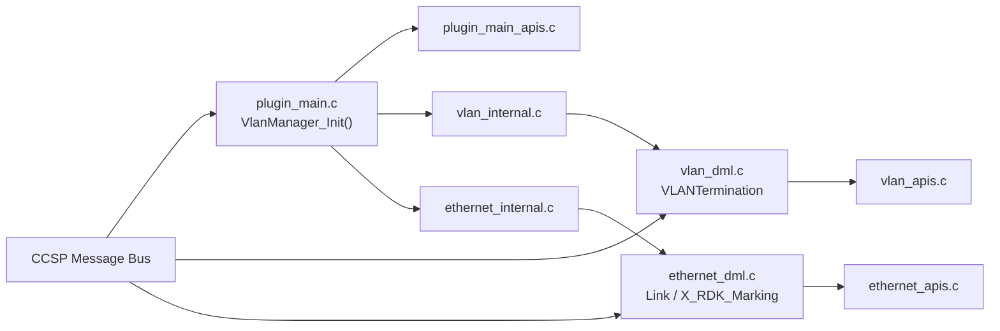

# Data Model Layer

## Overview

The data model layer implements the TR-181 subtrees `Device.X_RDK_Ethernet.Link.*` and `Device.X_RDK_Ethernet.VLANTermination.*`. It is located in `source/TR-181/middle_layer_src/`. It maps CCSP parameter get and set requests to the VLAN and Ethernet link operations described in [vlan-termination.md](vlan-termination.md) and [eth-link.md](eth-link.md).

The object layout is defined in `config/RdkVlanManager.xml`.

---

## Architecture

---

## Object Model

| Object                                | Table type     | Max instances | Purpose                                              |
| ------------------------------------- | -------------- | ------------- | ---------------------------------------------------- |
| `Device.X_RDK_Ethernet.Link.{i}.`     | `staticTable`  | 128           | Untagged link and priority tagging control            |
| `Device.X_RDK_Ethernet.Link.{i}.X_RDK_Marking.{i}.` | `dynamicTable` | 128 | Egress priority marking entries for a link     |
| `Device.X_RDK_Ethernet.VLANTermination.{i}.` | `staticTable` | 128           | Tagged VLAN interface definition                      |

### Parameters

#### `Link`

| Parameter           | Type    | Writable | Notes                                          |
| ------------------- | ------- | -------- | ---------------------------------------------- |
| `Enable`            | boolean | Yes      | Calls `EthLink_Enable` or `EthLink_Disable`    |
| `Status`            | enum    | No       | Up, Down, Unknown, Dormant, NotPresent, LowerLayerDown, Error |
| `Alias`             | string(64) | Yes   | Instance alias                                 |
| `Name`              | string(64) | Yes   | Linux interface name                           |
| `LowerLayers`       | string(1024) | Yes | Lower-layer path                               |
| `X_RDK_BaseInterface` | string(64) | Yes | Base interface used to create the VLAN          |
| `MACAddress`        | string(17) | No    | MAC address of the interface                   |
| `MACAddrOffSet`     | int     | Yes      | Offset applied to the base MAC address          |
| `PriorityTagging`   | boolean | Yes      | When `false`, an untagged VLAN interface is created |
| `X_RDK_Refresh`     | boolean | Yes      | Setting `true` starts the refresh thread when `Enable` is true |

#### `X_RDK_Marking`

| Parameter            | Type         | Writable | Notes                                  |
| -------------------- | ------------ | -------- | -------------------------------------- |
| `SKBPort`            | unsignedInt  | No       | Socket buffer port identifier           |
| `EthernetPriorityMark` | int        | Yes      | Ethernet priority value for the marking |

#### `VLANTermination`

| Parameter            | Type         | Writable | Notes                                   |
| -------------------- | ------------ | -------- | --------------------------------------- |
| `Enable`             | boolean      | Yes      | Calls `Vlan_Enable` or `Vlan_Disable`   |
| `Status`             | enum         | No       | Same enum as `Link`                     |
| `Alias`              | string(64)   | Yes      | Instance alias                          |
| `Name`               | string(64)   | Yes      | Linux interface name                    |
| `LastChange`         | unsignedInt  | No       | Time of the last state change           |
| `LowerLayers`        | string(1024) | Yes      | Lower-layer path                        |
| `VLANID`             | int          | Yes      | VLAN identifier                         |
| `TPID`               | unsignedInt  | Yes      | Tag protocol identifier                 |
| `X_RDK_BaseInterface` | string(64)  | Yes      | Base interface used to create the VLAN   |

---

## Core Functions

### `VlanManager_Init()`

#### Purpose

Plugin initialisation callback, set as `InitLibrary` in `ssp_create()`. It registers the COSA plugin functions used by the middle layer. The PSM-backed table initialisation is performed by `VlanInitialize` in `vlan_internal.c` and `EthLink_Init` in `ethernet_internal.c`.

#### Processing

1. Validates the requested plugin version and sets the plugin version.
2. Acquires the COSA functions needed to read and write parameters by path name.
3. `VlanInitialize` calls `Vlan_Init`, which calls `vlan_eth_hal_init` when `VLAN_MANAGER_HAL_ENABLED` is defined, then calls `VlanTerminationInitialize`.
4. `EthLink_Init` loads the Link table from PSM.

---

### `Vlan_SetParamBoolValue()`

#### Purpose

Handles `Enable` on `VLANTermination`.

#### Processing

1. Returns immediately if the requested value equals the current value.
2. Starts `Vlan_Enable` or `Vlan_Disable` in a detached thread.

See [vlan-termination.md](vlan-termination.md).

---

### `EthLink_SetParamBoolValue()`

#### Purpose

Handles `Enable`, `PriorityTagging`, and `X_RDK_Refresh` on `Link`.

#### Processing

1. For `Enable`, returns immediately if the value is unchanged. Otherwise it calls `EthLink_Enable` or `EthLink_Disable` synchronously.
2. For `PriorityTagging`, stores the value only.
3. For `X_RDK_Refresh`, starts `EthLink_RefreshHandleThread` when `Enable` is true.

See [eth-link.md](eth-link.md).

---

## Persistent Configuration

At startup, the middle layer reads the saved configuration from PSM.

- VLAN termination (`vlan_internal.c`): `dmsb.vlanmanager.ifcount` and `dmsb.vlanmanager.<n>.{VlanEnable, alias, name, lowerlayers, vlanid, tpid, baseinterface, path}`.
- Ethernet link (`ethernet_internal.c`): `dmsb.ethlink.ifcount` and `dmsb.ethlink.<n>.{Enable, alias, name, lowerlayers, macoffset, baseiface, path}`.

The full key list is in the [configuration guide](../configuration-guide.md).

---

## Build Notes

`vlan_internal.c` contains a `_HUB4_PRODUCT_REQ_` branch. This branch filters the initial configuration by region, using `dmsb.vlanmanager.cfg.*` keys and `platform_hal_GetRouterRegion`. It is compiled only when that macro is defined.
