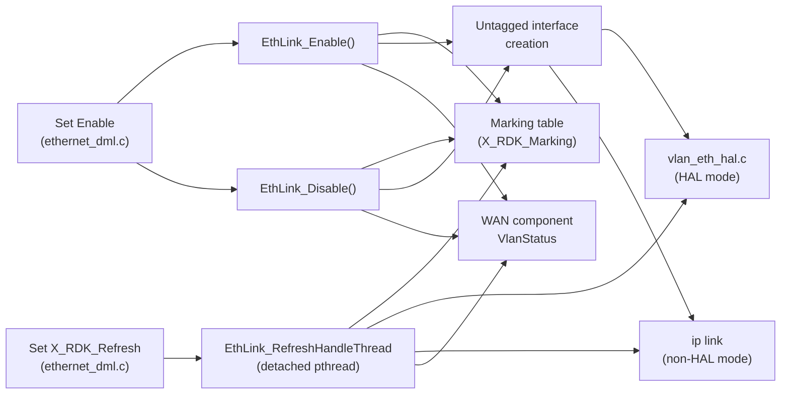

# Ethernet Link

## Overview

The Ethernet link component manages `Device.X_RDK_Ethernet.Link.{i}.` instances. Each instance represents an untagged VLAN link on a base Ethernet interface, and owns an `X_RDK_Marking` table of egress priority markings. Priority tagging decides whether an untagged VLAN interface is created.

The implementation is in `source/TR-181/middle_layer_src/ethernet_apis.c`, with parameter handling in `ethernet_dml.c` and PSM loading in `ethernet_internal.c`.

---

## Architecture

---

## Key Components

### Files

| Type   | Path                                                        |
| ------ | ----------------------------------------------------------- |
| Source | `source/TR-181/middle_layer_src/ethernet_apis.c`            |
| Source | `source/TR-181/middle_layer_src/ethernet_dml.c`             |
| Source | `source/TR-181/middle_layer_src/ethernet_internal.c`        |
| Header | `source/TR-181/include/ethernet_apis.h`                     |

---

## Core Functions

### `EthLink_Enable()`

#### Purpose

Enables the link. It adds the marking table and, when `PriorityTagging` is `false`, creates the untagged VLAN interface.

#### Processing

1. Calls `EthLink_AddMarking`. A failure is logged and processing continues without marking.
2. If `PriorityTagging` is `false`:
   1. Reads the current status of the untagged interface.
   2. Calls `EthLink_CreateUnTaggedInterface`.
   3. Polls the status up to 10 times, with a 2-second wait between attempts.
   4. Sends `Up` to the WAN component.
3. Sets `Status` to `Up`.

---

### `EthLink_Disable()`

#### Purpose

Disables the link. It removes the marking table and, when `PriorityTagging` is `false`, removes the untagged VLAN interface.

#### Processing

1. Calls `EthLink_DeleteMarking`. A failure returns an error.
2. If `PriorityTagging` is `false`:
   1. Reads the current status of the untagged interface.
   2. In HAL mode, deletes the interface with `vlan_eth_hal_deleteInterface`.
   3. In non-HAL mode, deletes the interface with `EthLink_DeleteUnTaggedInterface`.
3. Sets `Status` to `Down`.
4. Sends `Down` to the WAN component.

---

### `EthLink_CreateUnTaggedInterface()`

#### Purpose

Creates the untagged VLAN interface on the base interface. The method depends on the build.

#### Processing

1. **HAL mode** (`VLAN_MANAGER_HAL_ENABLED`): calls `vlan_eth_hal_createInterface` with the link configuration and the default VLAN ID.
2. **Non-HAL mode**:
   1. Removes an existing interface with the same name, if one is present (`ip link set ... down` and `ip link delete`).
   2. Runs `ip link add link <base> name <Name> [address <MAC>] type macvlan mode private`. The MAC address is omitted when it cannot be obtained.
   3. Sets `allmulticast` and `multicast` on, sets MTU to 1500, and sets the interface `up`.

Other builds that define `COMCAST_VLAN_HAL_ENABLED` call `EthLink_CreateBridgeInterface` instead. The source marks this path as a TODO.

---

### `EthLink_RefreshHandleThread()`

#### Purpose

Refreshes the marking table and the VLAN interface. It runs when `X_RDK_Refresh` is set to `true` on an enabled link.

#### Processing

1. Detaches the thread.
2. Calls `EthLink_AddMarking`.
3. Calls `EthLink_TriggerVlanRefresh`.

`EthLink_TriggerVlanRefresh` then:

1. Reads the VLAN ID and TPID for the link (`EthLink_GetVlanIdAndTPId`).
2. Reads the markings (`EthLink_GetMarking`).
3. In HAL mode, sends the markings with `vlan_eth_hal_setMarkings`. In non-HAL mode, applies them with `EthLink_SetEgressQoSMap`, which runs `ip link set <iface> type vlan egress-qos-map`.
4. Polls the interface status up to 10 times, with a 2-second wait between attempts.
5. Sends `Up` to the WAN component when the interface is up.

---

## WAN Status Notification

`EthLink_SendVirtualIfaceVlanStatus(path, status)` writes `<path>.VlanStatus` to the WAN component. It uses the CCSP call `DmlEthSetParamValues` with the component name `WAN_COMPONENT_NAME` and the bus path `WAN_DBUS_PATH`. The status value is `Up` or `Down`.

---

## Platform-Specific Code

- The file also contains WAN bridge configuration code (`EthLink_CreateBridgeInterface`) that is compiled only under `COMCAST_VLAN_HAL_ENABLED`. Its details are not described in this document.

---

## Notes

- A `TODO` in `ethernet_apis.c` says a marking add failure should be retried. The current code does not retry. It logs the error and creates the VLAN without markings.
