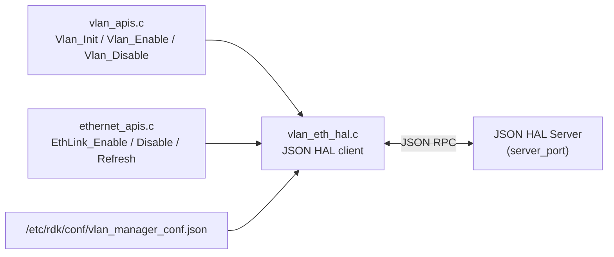

# HAL Abstraction

## Overview

The HAL abstraction is the JSON HAL client in `source/TR-181/middle_layer_src/vlan_eth_hal.c`. It sends VLAN interface, marking, and delete requests to a JSON HAL server. It is compiled only when `VLAN_MANAGER_HAL_ENABLED` is defined. Without this macro, the VLAN interface operations run through Linux networking commands instead.

The HAL contract is defined by `hal_schema/ethlinkvlanterm_hal_schema.json`.

---

## Architecture

---

## Initialisation

`vlan_eth_hal_init()` performs the following steps:

1. Calls `json_hal_client_init` with the configuration path `/etc/rdk/conf/vlan_manager_conf.json`.
2. Calls `json_hal_client_run`.
3. Waits up to 10 seconds for the client to connect (`json_hal_is_client_connected`).

---

## Requests

| Operation                  | Function                       | JSON action      | Parameters                                                                                                           |
| -------------------------- | ------------------------------ | ---------------- | -------------------------------------------------------------------------------------------------------------------- |
| Create tagged interface    | `vlan_eth_hal_createInterface` | `setParameters`  | `Device.Ethernet.VLANTermination.<n>.Alias`, `.Name`, `.VLANID`, `.TPID`                                            |
| Create untagged interface  | `vlan_eth_hal_createInterface` | `setParameters`  | Same parameters, with the link's alias and name and the default VLAN ID                                            |
| Apply markings             | `vlan_eth_hal_setMarkings`     | `setParameters`  | `Device.Ethernet.Link.<n>.X_RDK_Marking.<m>.SKBPort`, `.EthernetPriorityMark`                                       |
| Delete untagged interface  | `vlan_eth_hal_deleteInterface` | `setParameters`  | `Device.Ethernet.Link.<n>.Enable` set to `false`, `Device.Ethernet.Link.<n>.Name` set to the interface name         |

The `deleteObject` action is defined in the schema and the code has a constant for it. The current code does not send a `deleteObject` request.

Each request reads the result with `json_hal_get_result_status`.

---

## Configuration

| File                                                 | Setting            | Value                                                      |
| ---------------------------------------------------- | ------------------ | ---------------------------------------------------------- |
| `/etc/rdk/conf/vlan_manager_conf.json`               | `hal_schema_path`  | `/etc/rdk/schemas/ethlinkvlanterm_hal_schema.json`         |
| `/etc/rdk/conf/vlan_manager_conf.json`               | `server_port`      | `4096`                                                     |

See the [configuration guide](../configuration-guide.md) for the full runtime configuration.

---

## HAL Schema

The schema in `hal_schema/ethlinkvlanterm_hal_schema.json` defines:

| Item       | Value                                                                  |
| ---------- | ---------------------------------------------------------------------- |
| `module`   | `ethvlanhal`                                                           |
| Actions    | `getParameters`, `setParameters`, `deleteObject`, `getSchema`          |

The example message `hal_schema/example_setParameters.json` uses the module name `vlanhal`. The other examples use `ethvlanhal`. Integrators should use the module name defined in the schema.

---

## Behaviour Without HAL

When `VLAN_MANAGER_HAL_ENABLED` is not defined:

- VLAN termination uses `ip link add ... type vlan` and `ip link delete`.
- Untagged links use `ip link ... type macvlan`.
- Markings are applied with `ip link set ... egress-qos-map`.
