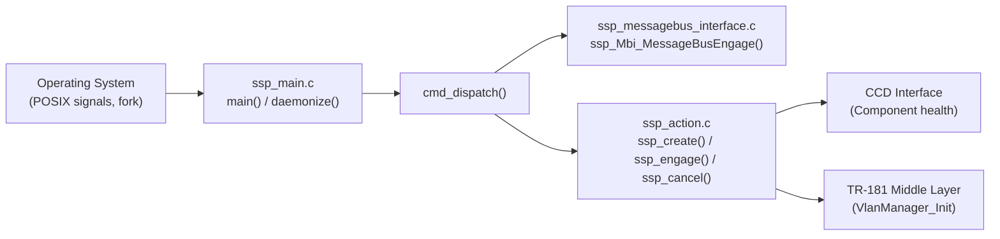

# SSP (Service Process)

## Overview

The SSP layer forms the entry point and process management shell of VLAN Manager. It implements the CCSP Service/System Process (SSP) pattern. It handles daemon lifecycle, CCSP message bus engagement, component identity and health reporting, and data model registration with the CCSP framework.

The SSP layer does not contain VLAN-specific logic. It establishes the CCSP hosting environment within which the TR-181 data model operates.

---

## Architecture

---

## Key Components

### Files

| Type   | Path                                               |
| ------ | -------------------------------------------------- |
| Source | `source/RdkVlanManager/ssp_main.c`                 |
| Source | `source/RdkVlanManager/ssp_action.c`               |
| Source | `source/RdkVlanManager/ssp_messagebus_interface.c` |
| Header | `source/RdkVlanManager/ssp_internal.h`             |
| Header | `source/RdkVlanManager/ssp_global.h`               |
| Header | `source/RdkVlanManager/ssp_messagebus_interface.h` |

---

## Core Functions

### `main()`

#### Purpose

Process entry point. Parses command-line arguments, initialises the RDK logger, optionally daemonises, writes the PID file, initialises the VLAN mutex, engages CCSP, and enters the main loop.

#### Inputs

| Argument           | Description                                                  |
| ------------------ | ------------------------------------------------------------ |
| `-subsys <prefix>` | Sets the CCSP subsystem prefix                               |
| `-c`               | Runs in foreground (console) mode instead of daemon mode     |

#### Outputs

- PID written to `/var/tmp/vlanmanager.pid`.
- Sentinel file `/tmp/vlanmanager_initialized` created after initialisation.
- In daemon mode: enters a 30-second sleep loop.

#### Processing

1. Parses `-subsys` and `-c` flags.
2. Calls `rdk_logger_init("/etc/debug.ini")`.
3. Calls `daemonize()` unless console mode is selected.
4. Writes the PID to `/var/tmp/vlanmanager.pid`.
5. Calls `VLAN_InitMutex()`.
6. Engages the message bus and creates and engages the component.
7. Calls `Cdm_Init()`.
8. Sends `sd_notify READY=1` when built with `ENABLE_SD_NOTIFY`.
9. Creates `/tmp/vlanmanager_initialized`.
10. Enters the daemon loop, or reads commands from standard input in console mode.

---

### `daemonize()`

#### Purpose

Forks the process into the background and calls `setsid()` to start a new session. Standard file descriptors are redirected to `/dev/null` unless `_DEBUG` is defined.

---

### `cmd_dispatch()`

#### Purpose

Dispatches runtime commands. In console mode, the following commands are read from standard input.

| Command | Action                                                                  |
| ------- | ----------------------------------------------------------------------- |
| `e`     | Engage: message bus engagement, component creation, component engage  |
| `m`     | Print component memory table                                            |
| `t`     | Print ANSC memory trace table                                           |
| `c`     | Cancel: unregister the component and free its objects                   |
| `q`     | Quit                                                                    |

---

### `ssp_create()`

#### Purpose

Allocates and initialises the component data structures. It creates the CCD interface and the library callback interface, and creates the DSLH CPE Controller.

#### Processing

1. Allocates the component common structure and sets its name to the VLAN Manager component name.
2. Creates the CCD interface and binds its callbacks.
3. Creates the library callback interface, with `InitLibrary` set to `VlanManager_Init`.
4. Calls `DslhCreateCpeController()`.

---

### `ssp_engage()`

#### Purpose

Registers the component and its data model with the message bus.

#### Processing

1. Adds the CCD and library callback interfaces to the component.
2. Calls `RegisterCcspDataModel2` with the data model XML generated by `DMPackCreateDataModelXML`.
3. Sets component health to Yellow during registration, then to Green on success.

---

### `ssp_cancel()`

#### Purpose

Unregisters the component from the message bus and frees the component objects.

---

## Message Bus Engagement

`ssp_Mbi_MessageBusEngage()` in `ssp_messagebus_interface.c` performs the following steps:

1. Initialises the CCSP message bus (`CCSP_Message_Bus_Init`).
2. Sets the bus callback (`CcspBaseIf_SetCallback`).
3. Registers the `currentSessionIDSignal` event (`CcspBaseIf_Register_Event`).

---

## Notes

- `DMPackCreateDataModelXML` is referenced in `ssp_action.c`. The `dm_pack_datamodel.c` source file that defines it is not present in this repository. The data model is described by `config/RdkVlanManager.xml`.
