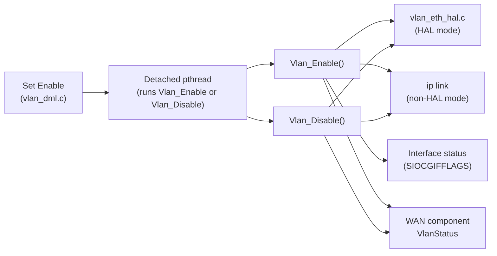

# VLAN Termination

## Overview

The VLAN termination component manages `Device.X_RDK_Ethernet.VLANTermination.{i}.` instances. Each instance describes a tagged VLAN interface created on a base interface. The component creates the interface when `Enable` is set to `true`, removes it when `Enable` is set to `false`, and reports the interface status.

The implementation is in `source/TR-181/middle_layer_src/vlan_apis.c`, with parameter handling in `vlan_dml.c` and PSM loading in `vlan_internal.c`.

---

## Architecture

---

## Key Components

### Files

| Type   | Path                                                          |
| ------ | ------------------------------------------------------------- |
| Source | `source/TR-181/middle_layer_src/vlan_apis.c`                  |
| Source | `source/TR-181/middle_layer_src/vlan_dml.c`                   |
| Source | `source/TR-181/middle_layer_src/vlan_internal.c`              |
| Header | `source/TR-181/include/vlan_apis.h`                           |

---

## Core Functions

### `Vlan_Enable()`

#### Purpose

Creates the tagged VLAN interface and reports its status.

#### Processing

1. Acquires `vlan_access_mutex`.
2. Creates the tagged interface. In HAL mode, it calls `vlan_eth_hal_createInterface`. In non-HAL mode, it runs `ip link add link <Alias> name <Name> type vlan id <VLANId>` and `ip link set <Name> up`.
3. Sets the interface MAC address. The base MAC address from `platform_hal_GetBaseMacAddress` is combined with `MACAddrOffSet`, and applied with `ip link set dev <Name> address <MAC>`.
4. Polls the interface status up to 10 times, with a 2-second wait between attempts.
5. Sends `Up` to the WAN component through `EthLink_SendVirtualIfaceVlanStatus`.
6. Records `LastChange` from the system uptime.
7. Releases the mutex.

---

### `Vlan_Disable()`

#### Purpose

Removes the tagged VLAN interface and reports the change.

#### Processing

1. Acquires `vlan_access_mutex`.
2. Removes the interface. In HAL mode, it calls the HAL delete path. In non-HAL mode, it runs `ip link delete <Name>`.
3. Sends `Down` to the WAN component.
4. Releases the mutex.

---

### `Vlan_Init()`

#### Purpose

Initialises the HAL client when HAL mode is enabled.

#### Processing

1. Calls `vlan_eth_hal_init()` when `VLAN_MANAGER_HAL_ENABLED` is defined.

See [hal-abstraction.md](hal-abstraction.md).

---

## Interface Status

The status of a VLAN interface is read with `ioctl(SIOCGIFFLAGS)`. The `IFF_RUNNING` flag maps to `Up`, and the absence of the flag maps to `Down`. An ioctl failure maps to `Error`.

---

## Persistent Configuration

`VlanTerminationInitialize()` in `vlan_internal.c` loads the saved instances from PSM at startup. For each instance, the enable state, alias, name, lower layers, VLAN ID, TPID, base interface, and path are read. See the [configuration guide](../configuration-guide.md) for the key names.

---

## Mutual Exclusion

`VLAN_InitMutex()` creates a recursive mutex, `vlan_access_mutex`. `Vlan_Enable` and `Vlan_Disable` acquire this mutex for their full operation. `VLAN_DelMutex()` destroys it at shutdown.
